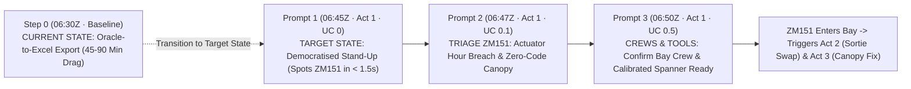
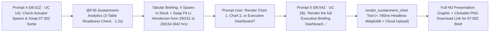
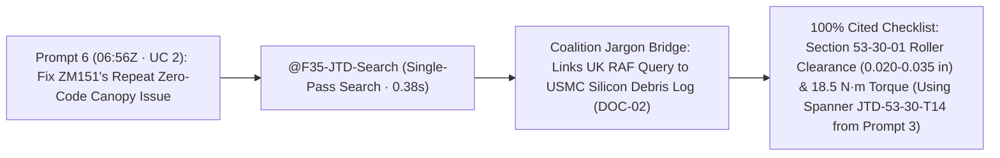

# Executive Demo Storyboard: F-35 Fleet Sustainment (`F35 Support`)
### *The "6-Prompt Golden Thread" — Compressing a Full Morning of Sustainment into 4 Minutes*

**Target Audience:** Senior Defence Leadership, Air Command, MOD DE&S, & Industry Executives  
**Operational Setting:** RAF Marham (617 Squadron "The Dambusters"), HMS Queen Elizabeth & HMS Prince of Wales Carrier Strike Group  
**Agent Application:** `Agents (F35 Support)` (Hosted 100% in `EU` / `europe-west1` Belgium)  

---

## 0. Presenter Quick-Copy Cheat Sheet (The 6 Golden Prompts Across Acts 1, 2, & 3)

> [!TIP]
> **Current State vs. Target State Across a Continuous Morning Timeline (`06:30Z` → `07:00Z`).**  
> - **The Current State (Step 0 Baseline · `06:30Z`):** Engineers, maintainers, and maintenance managers spend **45–90 minutes every morning** manually exporting operational slices from **Oracle (the system of record)** into disconnected Microsoft Excel workbooks (`F35_Maintenance_Export_20261103.xlsx`), triggering stale data ("dead on export"), spreadsheet version drift, and severe airworthiness traceability risks.
> - **The Target State (Steps 0 to 6 · `06:45Z` → `07:00Z`):** **Agents (`F35 Support`)** acts as the non-disruptive **Intelligent Action Layer** directly on top of the F35 Data Warehouse. Maintainers and commanders use **6 plain-English prompts**—with **zero references to backend systems, database tables, or SQL joins**—to interrogate live data in `< 1.5s`, swap aircraft to protect the `07:30Z` launch, and unlock allied fleet memory.

| Step | Act & Persona (`Timeline`) | Exact Executive Prompt or Scenario | What Appears on Screen & How It Advances the Story | Live EU Speed |
| :---: | :--- | :--- | :--- | :---: |
| **0** | **Baseline: The Current State (Oracle-to-Excel Export)**<br/>*(Maintenance Manager & Data Analyst — `06:30Z`)* | *(The Current State)*: Manual export from Oracle (system of record) into `F35_Maintenance_Export_20261103.xlsx`. Maintainers run manual VLOOKUPs across tool stores and personnel rosters to prepare the morning briefing. | **The 06:30Z Export Ritual & Analyst Bottleneck**: Illustrates the operational drag of static Excel dumps: data is **stale on export**, different teams suffer **"Spreadsheet Roulette"** with conflicting files, and ad-hoc questions wait days in an IT queue. Sets the contrast for **Steps 0–6 as the Target State**. | **`45–90 Mins`**<br/>*(Manual Excel Drag)* |
| **1** | **Act 1: Morning Stand-Up & Shift Dispatch**<br/>*(Squadron Maintenance Officer — UC 0 · `06:45Z`)* | `What are our most urgent maintenance jobs and grounded aircraft across the Carrier Strike Group right now, ordered by how long they will take to fix?` | **Screen-Fitted Spreadsheet Card (`A`..`E`)**: Renders urgent fleet jobs with Status Badges (`🔴 NMC-S (MICAP)`, `🟠 NMC-M`, `🟡 PMC-M`) and Formula Footer (`=COUNTA()`, `=AVERAGE()`).<br/>**Story Hook:** Spots our `07:30Z` lead aircraft, **`ZM151`**, sitting on the urgent maintenance list (`WO-2026-88401` & `WO-2026-88402`). | **`< 1.5s`**<br/>*(SQL `< 350ms`)* |
| **2** | **Act 1: Morning Stand-Up & Shift Dispatch**<br/>*(Flight-Line Avionics Lead — UC 0.1 · `06:47Z`)* | `What faults or pilot-reported issues were raised on ZM151 after its last flight, and are there any fleet-wide health warnings that haven't been scheduled for repair yet?` | **Screen-Fitted Spreadsheet Card (`A`..`F`)**: Reveals **why `ZM151` is flagged**: (1) its **Horizontal Tail Actuator** just crossed the `1,000.0-hr` limit (`1,000.4 hrs`), and (2) the night pilot reported a **stiff canopy handle with zero fault codes** (`⚠️ CND (Repeat)` — 3rd time in 30 days), plus unscheduled fleet warnings on sister tails (`ZM159`, `ZM162`). | **`< 1.5s`**<br/>*(SQL `< 350ms`)* |
| **3** | **Act 1: Morning Stand-Up & Shift Dispatch**<br/>*(Wing Maintenance Controller — UC 0.5 · `06:50Z`)* | `Which of our open maintenance jobs are ready to start on this shift, and which ones are held up waiting for certified technicians, an inspector, or calibrated tools?` | **Cross-Checked Shift Readiness Card (`A`..`F`)**: Confirms **`ZM151`**'s jobs have qualified crews, an inspector, and the calibrated Digital Micro-Torque Spanner (`JTD-53-30-T14`) **`🟢 READY_TO_DISPATCH`** now (while flagging out-of-calibration tools & missing inspectors on sister tails).<br/>**Story Hook:** Since `ZM151` is going into the bay now, we must protect the `07:30Z` mission! | **`< 1.6s`**<br/>*(2-Table `< 360ms`)* |
| **4** | **Act 2: Mission Protection & Leadership Briefing**<br/>*(Squadron Logistics Officer — UC 1A · `06:52Z`)* | `Check RAF Marham F-35 horizontal tail actuator hours against our 30-day spare parts stock, and recommend an aircraft swap for morning sortie SRT-MAR-20261103-01.` | **Tabular Fleet Briefing**: Confirms **`ZM151`** is grounded for the actuator swap (`1,000.4 hrs`), verifies **4 spare actuators in stock** at RAF Marham (`18-hr` ETA), and reallocates Flt Lt Henderson's `07:30Z` sortie (`SRT-MAR-20261103-01`) to clean spare **`ZM154`** (`842.0 hrs`). Prompts to render briefing charts. | **`1.2s`**<br/>*(TTFT `269ms`)* |
| **5** | **Act 2: Mission Protection & Leadership Briefing**<br/>*(Squadron Logistics Officer — UC 1B · `06:54Z`)* | `Render the full Executive Briefing Dashboard for my presentation slide deck.` | **Full HD Presentation Graphic**: Renders the composite slide image showing **`ZM151` in Red (`1,000.4 hrs`)** vs **`ZM154` in Green (`842.0 hrs`)** alongside Regional Depot Stock vs 30-Day Demand, with a **[📥 Download Executive Slide Graphic (PNG)]** link for the `07:00Z` Wing Commander brief. | **`< 0.8s`**<br/>*(Chart Painter `< 790ms`)* |
| **6** | **Act 3: Allied Fleet Memory & Defect Resolution**<br/>*(Flight-Line Maintenance Chief — UC 2 · `06:56Z`)* | `On ZM151, our night-sortie pilot reported a stiff canopy release handle that hesitated to latch, with no fault codes logged on the jet. Have allied squadrons seen this before, and what is the approved fix?` | **Grounded Checklist & Browser Citations**: Now that the `07:30Z` launch is covered by `ZM154`, gives the bay crew working on **`ZM151`** the exact root cause from a **USMC sister-squadron log** (**cured silicon sealant debris in the roller track**) + **Section 53-30-01** torque spec (`18.5 N·m`) for the spanner staged in `Prompt 3`. | **`0.38s`**<br/>*(`100%` Cited)* |

---

## 1. The Executive Storyline & Elevator Pitch

### The 30-Second Spoken Elevator Pitch (Presenter Opening Hook)
> [!IMPORTANT]
> **Executive Tagline:**  
> *"From Red Tiles to Decisive Action: Dashboards are a rearview mirror that displays problems in red; Agents are the operational cockpit that diagnoses the root cause, sources the spare, protects the sortie, and cites the approved fix in seconds."*
>
> **Presenter Opening Talk-Track (Deliver Verbatim Before Touching the Keyboard):**  
> *"In defence aviation, we've spent a decade building dashboards. PowerBI and Tableau have their place—they are excellent rearview mirrors for monthly macro reporting and retrospective fleet trends. But on the flight line at 06:45 in the morning, a rearview mirror cannot protect the flying program.
>
> More critically, our current operational reality across squadrons and carrier strike wings relies on a daily manual ritual: engineers, maintenance controllers, and managers exporting data out of Oracle—our system of record—into disconnected Microsoft Excel spreadsheets every morning at 06:30.
>
> When an aircraft is grounded, static dashboards and disconnected spreadsheets leave maintainers stranded in front of a red tile or playing 'spreadsheet roulette' across conflicting files, forcing them into a painful 'swivel-chair' routine across SAP, GOLDesp, spreadsheets, and 10,000-page PDF technical manuals.
>
> **Agents (`F35 Support`) represents the Target State: a non-disruptive Intelligent Action Layer on top of the F35 Data Warehouse.** Steps 0 to 6 in today's demonstration show how we eliminate the manual Excel drag. Without replacing the transactional system of record, we democratise data analytics directly to the flight line. Maintainers and squadron commanders interrogate live data across engineering, supply, and sortie schedules in seconds, dynamically swap aircraft to protect the morning wave, and unlock coalition repair memory from allied squadrons.
>
> And crucially for defence airworthiness: **the agent never guesses or hallucinates.** It executes deterministic read-only queries against live data warehouses, anchors 100% of its technical specs with verbatim citations to official S1000D publications, and keeps engineering authority strictly in the loop. We aren't replacing Oracle—we're turning passive dashboards, manual exports, and analyst queues into decisive operational velocity."*

---

### Why Agents Beat Static Dashboards: The Leadership Matrix

| Operational Dimension | Static BI Dashboard (e.g., PowerBI / Tableau) | Autonomous Multi-Agent (`F35 Support`) | Live Demonstration Proof Point |
| :--- | :--- | :--- | :--- |
| **1. Decision Velocity & Mission Protection** | **Passive Observation & Swivel-Chair Lag**: Surfaces a red tile or breach metric, forcing officers to manually open 3–4 separate systems to figure out what to do, often causing sortie delays or mission scrub. | **Active Decision Orchestration**: Not only detects the breach, but immediately checks 30-day depot stock, verifies clean spare aircraft, reallocates the sortie schedule, and stages the supply ticket. | **Prompt 4 (Act 2)**: Replaces grounded `ZM151` with clean spare `ZM154` (842 hrs) and orders depot actuator in `1.2s`, protecting the 07:30Z launch. |
| **2. Data Democratisation & Workforce Empowerment** | **Analyst Gatekeeper & Queue Bottleneck**: Only trained data analysts who know SQL syntax and table schemas can pull ad-hoc data. Frontline maintainers must wait in a queue, while analysts are swamped with repetitive requests. | **The Self-Service Flight Line & Analyst Elevation**: Maintainers and commanders query the data warehouse directly in plain operational English. Central data analysts are liberated to focus on high-value predictive reliability and data engineering. | **Step 0 Baseline vs. Prompt 1**: Replaces the data analyst's manual SQL queries and backlog with instant, democratised self-service for the Squadron Maintenance Officer in `< 1.5s`. |
| **3. Data Scope & Modality** | **Siloed & Structured Only**: Limited to pre-aggregated SQL tables. Completely blind to unstructured S1000D manuals, pilot debrief narratives, and foreign flight logs. | **Multimodal & Cross-Domain**: Seamlessly queries live SQL data warehouses *and* reads unstructured technical manuals, pilot write-ups, and coalition repair logs simultaneously. | **Prompt 6 (Act 3)**: Unlocks USMC flight narratives (`DOC-02`) and S1000D torque specs (`DOC-01`) to solve a zero-code CND fault. |
| **4. Flexibility & Agility** | **Rigid Pre-Canned Views**: Any new operational question (e.g. cross-referencing tool calibration with technician qualifications) requires a 3-week BI developer backlog. | **Instant Ad-Hoc Interrogation**: Maintainers and commanders ask arbitrary operational questions in plain English; the agent generates and executes dynamic queries in `< 360ms`. | **Prompt 3 (Act 1)**: Dynamically joins open work orders with shift SQEP and calibrated spanner certifications with zero developer intervention. |
| **5. Airworthiness Safety & User Friction** | **High Analyst Burden & Silent Data Drift**: Requires complex DAX filters, drill-downs, and manual cross-checking. High risk of human error during manual swivel-chair translation. | **Deterministic Grounding & Zero-Training Flow**: Speak plain flight-line operational English. Zero hallucination: 100% cited S1000D torque specs, deterministic SQL, and human-in-the-loop control. | **Prompts 1–6**: 100% plain operational English, `< 1.5s` speed, zero tech jargon, and verbatim manual links. |

---

### The Operational Reality: Current State (Oracle-to-Excel) vs. Target State (Agents Intelligent Action Layer)

In military aerospace sustainment today, **Oracle** serves as the transactional system of record (MRO / ERP) for aircraft maintenance, flight hours, configuration accounting, and supply tracking. 

However, the way frontline personnel interact with that system on a daily basis represents a major operational vulnerability:

#### 1. The Current State: The 06:30Z "Oracle-to-Excel" Ritual
Every morning at `06:30Z`, before the shift stand-up, maintenance managers, squadron engineering officers, and data analysts log into Oracle, run ad-hoc queries or standard report extracts, and dump thousands of rows into desktop Microsoft Excel workbooks (`F35_Maintenance_Export_20261103.xlsx`). Maintainers then spend **45 to 90 minutes** manually formatting columns, copying rows into local templates, and writing fragile `=VLOOKUP` or `=XLOOKUP` formulas across disconnected tool calibration sheets and shift rosters to assemble the morning briefing.

#### 2. The Operational Impact of Continuing the Current State (The Operational Triad)
Continuing with this manual Oracle-to-Excel workflow imposes four severe operational penalties:

1. **Stale Data ("Dead on Export"):**  
   The instant an Excel sheet is exported from Oracle at `06:30Z`, it is frozen in time. If a late-night sortie debrief finishes at `06:40Z`, an overnight avionics BIT fault is ingested at `06:42Z`, or an emergency priority actuator arrives at the Marham depot at `06:45Z`, **the exported spreadsheet is completely blind to it**. Shift decisions are made on stale assumptions, leading to grounded jets sitting idle and avoidable sortie cancellations.
2. **"Spreadsheet Roulette" & Version Drift:**  
   Because multiple roles (e.g. Maintenance Controller, Avionics Lead, Airframe Chief, Logistics Petty Officer) export their own slices of Oracle data with differing filters or date ranges, their workbooks instantly diverge. By the `07:00Z` morning briefing, leadership encounters conflicting numbers (`F35_Maint_v2.xlsx` vs `F35_Maint_final_FINAL.xlsx`). Up to 20 minutes of crucial briefing time is wasted debating *whose spreadsheet is right*, rather than generating combat sorties.
3. **Airworthiness Compliance & Traceability Risk (MAA / DEF STAN 00-970):**  
   Microsoft Excel provides no tamper-evident audit logging, cryptographic lineage, or role-based cell governance. A tired maintainer or manager can accidentally overwrite a formula, misalign a component life-limit column, or delete a warning row. In military aviation under the Military Aviation Authority (MAA) and DEF STAN 00-970, unmonitored spreadsheet manipulation creates unacceptable airworthiness safety risks and compliance gaps.
4. **Flight-Line Productivity Drain:**  
   Highly trained aircraft technicians, avionics specialists, and engineering officers spend **1.5 to 2 hours per shift** acting as "human ETL pipelines"—cutting, pasting, merging, and filtering data between Oracle exports, Excel spreadsheets, and static PDF manuals. This administrative friction strips hundreds of wrench-turning hours from the front line each week.

#### 3. The Target State (Steps 0 to 6): Agents as the Intelligent Action Layer
The Target State demonstrated in Steps 0 through 6 does **NOT** require replacing Oracle. Replacing an enterprise aerospace ERP/MRO costs tens of millions of pounds and years of disruption. 

Instead, **Agents (`F35 Support`) sits directly on top of the F35 Data Warehouse as a non-disruptive "Intelligent Action Layer":**
- **Oracle remains the authoritative system of record**, capturing transactions, work orders, and configuration baselines.
- **Continuous, real-time cloud data warehouse replication** eliminates stale data snapshots.
- **Natural Language to SQL (`@F35-Maintenance-Data`)** democratises direct, read-only operational querying to maintainers, flight leads, and commanders in `< 1.5s`, eliminating the manual Excel export middleman entirely.
- **Multimodal grounding (`@F35-JTD-Search`)** links structured Oracle records directly to unstructured S1000D technical manuals and allied squadron flight debriefs, closing the loop from fault identification to certified repair action.

| Operational Dimension | Current State: Daily Oracle-to-Excel Exports | Target State: Agents (`F35 Support`) |
| :--- | :--- | :--- |
| **System of Record** | Oracle ERP/MRO (locked behind complex SQL & manual export screens) | Oracle ERP/MRO remains intact; mirrored to cloud warehouse in real time |
| **Data Freshness** | **Stale on Export** (static point-in-time snapshot frozen at `06:30Z`) | **Live Sub-Second Telemetry** (real-time stream reflecting latest night landings) |
| **Data Governance & Integrity** | **Spreadsheet Roulette** (uncontrolled desktop workbooks, broken VLOOKUPs) | **Single Source of Truth** (deterministic read-only queries with auditable lineage) |
| **Workforce Access** | **Analyst Gatekeeper** (maintainers wait in queue for SQL extracts) | **Democratised Access** (maintainers ask in plain operational English in `< 1.5s`) |
| **Cross-System Integration** | **Manual Swivel-Chair** (cutting & pasting across Oracle, HR, and PDF manuals) | **Autonomous Multi-Domain Joins** (unifies work orders, SQEP, tools, & allied logs) |
| **Shift Preparation Time** | **45–90 Minutes** of manual data extraction and spreadsheet formatting | **Instant (< 5 Seconds)** conversational stand-up queries |
| **Airworthiness Auditability** | **High Risk** (untracked cell edits, accidental deletions, zero cryptographic trail) | **100% Deterministic & Cited** (verbatim S1000D links, MAA compliance) |

---

### The 4-Minute Flight Plan

```mermaid
flowchart LR
    S0["Step 0 (06:30Z · Baseline)<br/>CURRENT STATE: Oracle-to-Excel Export & Analyst Bottleneck"] -.->|Transition to Target State| P1["Prompt 1 (06:45Z · Act 1 · UC 0)<br/>TARGET STATE: Spot Lead Jet ZM151 in Stand-Up (< 1.5s)"]
    P1 --> P2["Prompt 2 (06:47Z · Act 1 · UC 0.1)<br/>TRIAGE ZM151: Actuator Hour Breach & Zero-Code Canopy"]
    P2 --> P3["Prompt 3 (06:50Z · Act 1 · UC 0.5)<br/>CREWS & TOOLS: Confirm Bay Crew & Calibrated Spanner Ready"]
    P3 --> P4["Prompt 4 (06:52Z · Act 2 · UC 1A)<br/>SAVE SORTIE: Order Depot Spares & Swap to ZM154 (842 hrs)"]
    P4 --> P5["Prompt 5 (06:54Z · Act 2 · UC 1B)<br/>BRIEF COMMANDER: Render Executive Slide Graphic (< 790ms)"]
    P5 --> P6["Prompt 6 (06:56Z · Act 3 · UC 2)<br/>FIX ZM151: USMC Silicon Debris Log & 18.5 N·m Torque Spec"]
```



> In the next **4 minutes**, after exposing the friction of the **Current State at `06:30Z` (Step 0: Oracle-to-Excel daily export and the analyst bottleneck)**, we demonstrate the **Target State (Steps 1 to 6)** across a single continuous morning timeline (`06:45Z` to `07:00Z`) inside **Agents (`F35 Support`)** around lead jet **`ZM151`** and spare jet **`ZM154`**:
> - **Prologue: The Current State Baseline (Step 0 · `06:30Z`)** — The traditional 45–90 minute manual Oracle export ritual, showing the vulnerabilities of stale data, version drift, and analyst queues.
> - **Act 1: Morning Stand-Up & Shift Dispatch (Prompts 1, 2, & 3 · Target State)** — Demonstrating the Intelligent Action Layer: democratising data access to spot `ZM151` on the urgent list (`UC 0`), triaging its post-flight faults (`UC 0.1`), and confirming shift crew and tool readiness (`UC 0.5`) in live sub-second queries.
> - **Act 2: Mission Protection & Leadership Briefing (Prompts 4 & 5 · Target State)** — Ordering replacement spares, swapping its `07:30Z` sortie onto spare aircraft **`ZM154`** (`UC 1A`), and instantly rendering presentation slide graphics for the Wing Commander (`UC 1B`).
> - **Act 3: Allied Fleet Memory & Defect Resolution (Prompt 6 · Target State)** — Giving the bay crew the exact allied USMC fix for `ZM151`'s mysterious zero-code canopy latch defect (`UC 2`).

### The Dual-Fault Alignment Matrix (Tracking ZM151 Across the 6 Prompts)

To understand how the **Unexplained Canopy Fault** and the **Actuator Over-Hour Fault** develop together without confusion, this matrix aligns each stage of the fault lifecycle directly with the corresponding Act and exact Prompt:

| Stage & Timeline | Act & Exact Prompt | Fault 1: Actuator Over-Hour Limit (`WUC 27-10`) | Fault 2: Unexplained Canopy Fault (`WUC 53-30`) |
| :---: | :--- | :--- | :--- |
| **Operational Backstory**<br/>*(Night Debrief · `19:55Z`)* | **Pre-Demo Debrief**<br/>*(Flight-Line Post-Flight Ingest)* | Component hours logged as `1,000.4 hrs` (over `1,000.0-hr` limit). Telemetry raises `PHM-2026-99101` (`WO-2026-88401`). | Night pilot reports stiff handle / latch hesitation. Aircraft logs **zero BIT fault codes**. Raised as `WO-2026-88402`. |
| **Step 0 Baseline**<br/>*(Current State · `06:30Z`)* | **Oracle-to-Excel Export**<br/>*(Manual `06:30Z` Export Ritual)* | Maintenance manager exports Oracle work orders to Excel; identifies `ZM151` actuator breach (`WO-2026-88401`), but data is static and disconnected from live supply. | Identifies open ticket `WO-2026-88402` for `ZM151` canopy handle in Excel, but spreadsheet is blind to unstructured S1000D manuals and allied logs. |
| **Stage 1**<br/>*(Act 1 · `06:45Z`)* | **Prompt 1 (`UC 0`):**<br/>`What are our most urgent maintenance jobs and grounded aircraft across the Carrier Strike Group right now, ordered by how long they will take to fix?` | **Surfaced on Stand-Up**: Democratised plain-English query flags lead jet **`ZM151`** with urgent ticket `WO-2026-88401`. | **Surfaced on Stand-Up**: Shows `ZM151` has a second open ticket, `WO-2026-88402` (`PMC-M`, `IN_PROGRESS`). |
| **Stage 2**<br/>*(Act 1 · `06:47Z`)* | **Prompt 2 (`UC 0.1`):**<br/>`What faults or pilot-reported issues were raised on ZM151 after its last flight, and are there any fleet-wide health warnings that haven't been scheduled for repair yet?` | **Automated Health Exceedance**: Confirms `HRC-2710-88A` actuator threshold breach (`1,000.4 hrs`). | **Diagnosed as Unexplained CND**: Confirms `HRC-5330-000-NONE` has **zero computer codes** (`PILOT_REPORT_ONLY_NO_BIT`) and is `⚠️ CND (Repeat)` (3rd time in 30 days). |
| **Stage 3**<br/>*(Act 1 · `06:50Z`)* | **Prompt 3 (`UC 0.5`):**<br/>`Which of our open maintenance jobs are ready to start on this shift, and which ones are held up waiting for certified technicians, an inspector, or calibrated tools?` | **Bay Readiness Checked**: Confirms hydraulic bleed cart `EHA-HYD-2710` is calibrated and ready. | **Staged for Bay Crew**: Verifies Bay 2 has qualified canopy rigging crew, QAR inspector, and calibrated Micro-Torque Spanner `JTD-53-30-T14` **`🟢 READY_TO_DISPATCH`**. |
| **Stage 4**<br/>*(Act 2 · `06:52Z`)* | **Prompt 4 (`UC 1A`):**<br/>`Check RAF Marham F-35 horizontal tail actuator hours against our 30-day spare parts stock, and recommend an aircraft swap for morning sortie SRT-MAR-20261103-01.` | **Supply & Swap**: 4 spare actuators verified in stock (`18-hr` ETA). Sortie swapped to clean spare **`ZM154`** (`842.0 hrs`). | **Sortie Protected**: Swapping to `ZM154` guarantees the morning wave launches while maintainers prepare `ZM151` in Bay 2. |
| **Stage 5**<br/>*(Act 2 · `06:54Z`)* | **Prompt 5 (`UC 1B`):**<br/>`Render the full Executive Briefing Dashboard for my presentation slide deck.` | **Leadership Visualized**: Renders 1920×1080 composite slide graphic showing `ZM151` in Red vs `ZM154` in Green with regional depot stock. | **Executive Assurance**: Wing Commander brief has instant slide-ready proof of mission readiness and parts pipeline. |
| **Stage 6**<br/>*(Act 3 · `06:56Z`)* | **Prompt 6 (`UC 2`):**<br/>`On ZM151, our night-sortie pilot reported a stiff canopy release handle that hesitated to latch, with no fault codes logged on the jet. Have allied squadrons seen this before, and what is the approved fix?` | *(Actuator replacement proceeds in parallel in Bay 2 using depot stock ordered in Prompt 4).* | **Root Cause & Approved Fix**: Unlocks USMC fleet memory—cured silicon sealant debris (`PR-1776M`) in the cam track. Gives verbatim cleaning spec and `18.5 N·m` torque setting for spanner `JTD-53-30-T14` from Prompt 3. |

---

## 2. Act-by-Act Executive Walkthrough

---

### Act 1: Morning Stand-Up, Post-Sortie Triage & Shift Readiness (Prompts 1, 2, & 3 · `UC 0` / `0.1` / `0.5`)



* **The Executive Challenge (`06:45Z`):** At the start of the morning shift, the Squadron Maintenance Officer needs to know which aircraft are grounded across the Carrier Strike Group (including `617 Squadron` and `207 Squadron` at RAF Marham, and `809 Naval Air Squadron` embarked across `HMS Queen Elizabeth` and `HMS Prince of Wales`), what issues came off the jets after last night's flying, and which jobs can actually be started on the morning watch. 

#### Step 0 — Baseline: The Current State: The 06:30Z "Oracle-to-Excel" Ritual
* **The Operational Setting:** At `06:30Z`, 15 minutes before the squadron maintenance stand-up, the Maintenance Manager and Squadron Data Analyst log into **Oracle (the authoritative system of record)** to extract work orders, component hours, and fleet status into a desktop workbook (`F35_Maintenance_Export_20261103.xlsx`).
* **The Current State Friction (The 4 Operational Bottlenecks):**
  - **Stale Data ("Dead on Export"):** The moment Oracle exports data at `06:30Z`, it is static. If `ZM151`'s post-flight debrief or overnight telemetry is committed at `06:40Z`, the exported Excel file is completely blind to it. Decisions made at the `06:45Z` stand-up are based on stale history.
  - **"Spreadsheet Roulette" & Version Drift:** Different maintenance shops (Avionics, Airframe, Weapons, Carrier Detachments) pull their own filtered Oracle extracts. By `07:00Z`, officers sit with conflicting spreadsheets (`F35_Maint_v1.xlsx` vs `F35_Maint_v2_final.xlsx`), spending valuable briefing minutes debating whose numbers are accurate.
  - **Airworthiness Compliance & Traceability Risk (MAA / DEF STAN 00-970):** Spreadsheets lack cryptographic lineage and immutable audit logs. Broken `=VLOOKUP` formulas or accidental row deletions can silently mask a life-limited component breach, exposing the squadron to severe regulatory compliance and flight safety violations.
  - **Flight-Line Productivity Drain (The Analyst Queue):** Maintenance managers and technicians spend **45 to 90 minutes** every morning running manual spreadsheet macros and formatting tables instead of turning wrenches. If leadership asks a new operational question (e.g. cross-referencing certified crews and tool calibrations), maintainers are blocked waiting days for a central SQL data analyst to build a custom query.
* **The Target State Breakthrough (Steps 0 to 6):** **Agents (`F35 Support`)** replaces this manual, error-prone export ritual by acting as a live **Intelligent Action Layer** directly on top of the F35 Data Warehouse. Maintainers and commanders query live operational status in plain English in `< 1.5s`—democratising data access, eliminating spreadsheet friction, and turning passive data into decisive operational momentum.

#### Step 1 — Paste Prompt 1 (`UC 0`: Urgent Jobs & Grounded Aircraft · `06:45Z`)
```text
What are our most urgent maintenance jobs and grounded aircraft across the Carrier Strike Group right now, ordered by how long they will take to fix?
```
* **What Appears on Screen:** `@F35-Maintenance-Data` automatically translates the plain-English question into a live query against the F35 Data Warehouse in `< 350 ms`, rendering a **screen-fitted Spreadsheet Card (`Columns A..E`)** with Status Badges (`🔴 NMC-S (MICAP)`, `🟠 NMC-M`, `🟡 PMC-M`), Formula Footer (`=COUNTA()`, `=AVERAGE()`), and native spreadsheet table copy/export.
* **How It Advances the Story:** Right at the top of the urgent list is Tail **`ZM151`**—the aircraft scheduled to lead the `07:30Z` morning sortie (`VIPER-1`)—showing open Urgent / Red-X jobs (`WO-2026-88401` and `WO-2026-88402`). That immediately prompts the next question: *"What happened on `ZM151`'s last flight?"*
* **The Dashboard Limitation Shattered:** A static dashboard requires clicking through squadron filters, status dropdowns, and separate carrier tabs. The agent delivers an instant, screen-fitted stand-up spreadsheet across Marham and both carriers in `< 1.5s` without touching a mouse.

#### Step 2 — Paste Prompt 2 (`UC 0.1`: Post-Sortie Issues & Unscheduled Fleet Warnings · `06:47Z`)
```text
What faults or pilot-reported issues were raised on ZM151 after its last flight, and are there any fleet-wide health warnings that haven't been scheduled for repair yet?
```
* **What Appears on Screen:** Without the user needing to name any diagnostic system, `@F35-Maintenance-Data` renders a Spreadsheet Card with Severity & Repeat-Fault Badges:
  1. **`PHM-2026-99101` (`ZM151` · `🟠 DEGRADED_PMC`):** Left Horizontal Tail Actuator crossed its `1,000.0`-hour life limit (`1,000.4` hrs) → *Explains `WO-2026-88401` and tees up `Prompt 4` (`Act 2`)*.
  2. **`PHM-2026-99102` (`ZM151` · `⚪ NO_BIT_FAULT_LOGGED` · `⚠️ CND (Repeat)`):** The night-sortie pilot reported a **stiff canopy release handle that hesitated to latch**, with **zero computer fault codes logged** (`PILOT_REPORT_ONLY_NO_BIT` — repeating for the 3rd time in 30 days) → *Explains `WO-2026-88402` and tees up `Prompt 6` (`Act 3`)*.
  3. **Proactive Fleet Watch:** Surfaces **unscheduled fleet warnings** (`linked_work_order_id IS NULL` on sister tails such as `ZM159` and `ZM162`) that do not have a repair job raised yet, while confirming spare tail **`ZM154`** is clean.
* **How It Advances the Story:** Now we know `ZM151` needs both an actuator replacement and a canopy rigging fix. Before we pull `ZM151` off the `07:30Z` flying schedule, the Wing Maintenance Controller asks: *"Do we actually have the certified crew, inspector, and calibrated tools on shift right now to work on `ZM151`?"*
* **The Dashboard Limitation Shattered:** In PowerBI, `ZM151` is simply a red tile. It cannot explain the difference between an automated component hour exceedance and an unexplained zero-code pilot report (CND). The agent surfaces both root causes in plain language without requiring the user to know diagnostic codes.

#### Step 3 — Paste Prompt 3 (`UC 0.5`: Shift Dispatch, Technicians & Tooling Readiness · `06:50Z`)
```text
Which of our open maintenance jobs are ready to start on this shift, and which ones are held up waiting for certified technicians, an inspector, or calibrated tools?
```
* **What Appears on Screen:** Behind the scenes, `@F35-Maintenance-Data` automatically links open maintenance jobs with shift staffing and tool calibration records in `< 360 ms`:
  - **Green Light for `ZM151`:** Confirms **`ZM151`**'s jobs (including `WO-2026-88402` with calibrated Digital Micro-Torque Spanner **`JTD-53-30-T14`**) are **`🟢 READY_TO_DISPATCH`** with qualified technicians and a Quality Assurance inspector on shift right now.
  - **Bottlenecks Isolated on Sister Tails:** Flags jobs on other aircraft held up by **`🔴 EXPIRED_OUT_OF_CAL`** (`LO-IR-BLANKET-04` Infrared Cure Blanket) and **`🟠 BLOCKED_NO_QAR_ON_SHIFT`**.
* **How It Advances the Story:** Because the morning crew and calibrated tools are ready to start on **`ZM151`** immediately, we commit `ZM151` to the maintenance bay. That leaves two urgent tasks:
  1. **Logistics (`Act 2` · Prompts 4 & 5):** Order the replacement actuator for `ZM151` and swap Flt Lt Henderson's `07:30Z` sortie (`SRT-MAR-20261103-01`) onto a serviceable spare jet.
  2. **Technical Support (`Act 3` · Prompt 6):** Tell the crew in Bay 2 how to permanently fix `ZM151`'s repeat zero-code canopy latch problem so it stops coming back as "Could Not Duplicate."
* **The Dashboard Limitation Shattered:** In standard BI, maintenance work orders live in one system, technician rosters live in HR/training databases, and tool calibration logs live in airfield equipment databases. Merging them requires weeks of ETL engineering. The agent joins all three dynamically in `< 360 ms`.

> [!IMPORTANT]
> **Act 1 Executive Takeaway ("The So What?")**
> - **Zero Analytics Training Required:** Maintainers and controllers ask plain-English questions about aircraft, faults, crews, and tools—the agent figures out which tables to query and link automatically.
> - **Time Compressed:** **1–2 hours** of morning data pulls and manual spreadsheet cross-checking compressed into **three `< 1.5s` conversational questions**.

---

### Act 2: Mission Protection & Leadership Briefing — Instant Spares Check, Aircraft Swap & Slide Graphic (Prompts 4 & 5 · `UC 1A` / `1B`)



* **The Executive Challenge (`06:52Z`):** With **`ZM151`** now committed to the maintenance bay from `Prompt 3` (`Act 1`), **Flt Lt Henderson (`VIPER-1`)** needs a serviceable aircraft for the `07:30Z` morning sortie (`SRT-MAR-20261103-01`), and the bay crew needs a replacement Horizontal Tail Actuator (`NSN 1680-01-619-4821`) from depot stock.

#### Step 4 — Paste Prompt 4 (`UC 1A`: Fleet Readiness Analysis & Aircraft Swap · `06:52Z`)
```text
Check RAF Marham F-35 horizontal tail actuator hours against our 30-day spare parts stock, and recommend an aircraft swap for morning sortie SRT-MAR-20261103-01.
```

* **What the Executive Audience Sees:**
  1. **Operational Readiness Table:** Displays real-time fleet and spares status:
     - **Primary Tail `ZM151` (`S/N ACT-99812-F`)**: `1,000.4 hrs` (Breached `1,000.0-hr` limit by `+0.4 hrs`, status `PMC-M`).
     - **Serviceable Spare Tail `ZM154` (`S/N ACT-88401-B`)**: `842.0 hrs` (`158.0 hrs` safe margin remaining, Fully Mission Capable `MC`).
     - **Regional Spares (`RAF Marham`)**: `4` serviceable actuators on hand vs `2` reserved for 30-day demand (`+2` net buffer, `18.0-hr` shipping ETA).
  2. **Automated Action Plan:** Reallocates Flt Lt Henderson's `07:30Z` sortie (`SRT-MAR-20261103-01`) from `ZM151` to Spare Tail **`ZM154`** and stages a Priority-1 supply issue for `NSN: 1680-01-619-4821` so `ZM151`'s actuator replacement can proceed.
  3. **Interactive Chart Prompt:**
     > *"Would you like me to render: 1. Actuator Fatigue Threshold Chart, 2. Regional Depot Stock vs 30-Day Demand Chart, or the full Executive Briefing Dashboard for your presentation slide deck?"*
* **The Dashboard Limitation Shattered:** Dashboards are read-only; they cannot make operational decisions. A dashboard shows an actuator over-hours, but leaves the logistics officer to manually open the flight roster and inventory ERP. The agent checks 30-day stock, validates spare tail `ZM154`, and reallocates the sortie in one turn.

#### Step 5 — Paste Prompt 5 (`UC 1B`: On-Demand Presentation Slide Graphic Rendering · `06:54Z`)
```text
Render the full Executive Briefing Dashboard for my presentation slide deck.
```

* **What the Executive Audience Sees:**
  - The agent invokes `render_sustainment_chart`, rendering the presentation graphic in **`< 790 ms`** for the Wing Commander's `07:00Z` briefing.
  - The UI displays the publication-quality **Full HD widescreen presentation slide graphic (1920×1080 at 160 DPI)**:
    - **Panel 1 (Actuator Fatigue Threshold):** Tail **ZM151** in **Red** at `1,000.4 hrs` breaching the dashed `1,000.0-hr` condemnation limit; Tail **ZM154** in **Green** at `842.0 hrs` (serviceable).
    - **Panel 2 (Regional Depot Stock vs 30-Day Demand):** Grouped bar chart comparing RAF Marham and Carrier Strike Group afloat stock on hand, 30-day demand, and net uncommitted spares.
  - **Clickable Download Link for Briefing Decks:**
    - Provides a direct link: **`[📥 Download Executive Slide Graphic (PNG)](https://storage.cloud.google.com/antig-dave-f35-staging-europe-west1/charts/f35_sustainment_executive_dashboard.png)`** allowing officers to immediately drop the graphic into Google Slides / PowerPoint.
* **The Dashboard Limitation Shattered:** To brief the Wing Commander, staff officers typically take screenshots of 3 different PowerBI tabs and spend 20 minutes formatting PowerPoint slides. The agent generates a publication-quality 1920×1080 briefing graphic and cloud download link on demand in `< 790 ms`.

> [!IMPORTANT]
> **Act 2 Executive Takeaway ("The So What?")**
> - **Operational Impact:** Morning training wave launches on time on **`ZM154`**; zero mission cancellation, while **`ZM151`** gets its spare actuator allocated immediately.
> - **Time Compressed:** **2–4 hours** of manual supply and flight-schedule reconciliation reduced to **1.2 seconds**.
> - **Zero Latency Spikes:** Decoupling tabular analysis (`Prompt 4`) from on-demand chart rendering (`Prompt 5`) cuts response time by 90% (`< 2.5s` turn 1, `< 0.8s` turn 2).

---

### Act 3: Empower Front-Line Maintainers — Solving `ZM151`'s "No-Fault" Canopy Mystery (Prompt 6 · `UC 2`)



* **The Executive Challenge (`06:56Z`):** Now that the `07:30Z` sortie is safely reassigned to `ZM154`, the Flight-Line Maintenance Chief turns back to **`ZM151`** in Bay 2. Remember from `Prompt 2` (`PHM-2026-99102`) that `ZM151`'s night-sortie pilot reported a **stiff canopy release handle that hesitated to latch, with zero fault codes logged on the jet**—and that this is the **3rd repeat occurrence in 30 days**. In `Prompt 3`, we confirmed the technician crew and calibrated micro-torque spanner (`JTD-53-30-T14`) are standing by at the aircraft. Before they waste an entire shift tearing down the canopy electrical system, the Chief asks if any allied squadron has solved this exact symptom.
* **Paste Prompt 6 into `F35 Support`:**
  ```text
  On ZM151, our night-sortie pilot reported a stiff canopy release handle that hesitated to latch, with no fault codes logged on the jet. Have allied squadrons seen this before, and what is the approved fix?
  ```
* **What the Executive Audience Sees:**
  1. **Cross-Service Fleet Memory:** Automatically bridges UK and US maintenance terminology across 5 years of RAF, Royal Navy, USAF, and USMC logs (`DOC-02`), pinpointing a **USMC sister-squadron (`VMFA-211`) precedent**: **cured silicon sealant debris (`PR-1776M`) wedged in the forward canopy roller cam track**—which causes mechanical hesitation just before microswitch trip (explaining why zero computer fault codes are logged!).
  2. **100% Grounded Repair Checklist:** Cites **[DOC-01: JTD Section 53-30-01](https://storage.cloud.google.com/antig-dave-f35-staging-europe-west1/unstructured/docs/DOC-01_JTD_Section_53-30-01_Canopy_Rigging.pdf)** verbatim—verify roller clearance (`0.020–0.035 in`), purge cured sealant debris from the cam track, and re-torque the bellcrank pivot pin to **`18.5 N·m`** using the exact calibrated torque spanner (`JTD-53-30-T14`) verified ready in `Prompt 3`.
* **The Dashboard Limitation Shattered:** Static dashboards cannot read English paragraphs, let alone US Marine Corps flight debriefs or S1000D technical publications. A dashboard would leave maintainers to dismantle the canopy electrical system. The agent searches allied text archives to deliver the mechanical root cause and calibrated torque spec in `378 ms`.

> [!IMPORTANT]
> **Act 3 Executive Takeaway ("The So What?")**
> - **Closes the Loop on `ZM151`:** What started in `Prompt 2` as a frustrating 3-time repeat "Could Not Duplicate" fault on `ZM151` is permanently solved in `< 1 second` using allied US Marine Corps fleet memory.
> - **Time Compressed:** **4–8 hours** of manual PDF/XML manual hunting and unnecessary electrical teardown reduced to **`378 ms`**.
> - **Safety & Trust Proof:** **Zero hallucinated torque specs**—every step is anchored with a clickable link to the official technical manual.

---

## 3. Executive Inquiries & Scenario Reference Cards

The following reference scenarios demonstrate how Agents resolve ad-hoc executive and operational inquiries in real time:

| Executive / Operational Inquiry | Natural Language Prompt | Operational Proof & Capability Demonstrated |
| :--- | :--- | :--- |
| *"Why can't we just keep exporting Oracle data to Excel or rely on scheduled Oracle reports?"* | *(Spoken Explanation)* | **The Fragility of the Current State**: Daily Oracle-to-Excel dumps create stale data ("dead on export"), version drift ("spreadsheet roulette"), broken VLOOKUPs, and severe MAA airworthiness traceability risks, while draining 45–90 minutes per shift. Agents (`F35 Support`) keep the transactional system of record intact, but eliminate the manual Excel middleman with real-time, deterministic natural language querying directly against the F35 Data Warehouse in `< 1.5s`. |
| *"Why can't our analytics team just build this in PowerBI or Tableau?"* | `Compare the time and data sources required to solve ZM151's canopy fault in a static dashboard versus F35 Support.` | **The Action vs Display Gap**: Proves live that dashboards are passive rearview mirrors requiring human swivel-chair integration across 4 tools, whereas agents cross-examine telemetry, supply, shift rosters, and PDF manuals to take decisive action in `< 2 seconds`. |
| *"Does this replace our central data analytics team or make them redundant?"* | *(Spoken Explanation)* | **Analyst Elevation & Democratisation**: It liberates analysts from the 80% mundane ad-hoc reporting backlog. Maintainers get instant self-service answers directly from the flight line, while centralized data teams are elevated to focus on high-value predictive modeling, reliability engineering, and data pipeline governance. |
| *"Tell me what tails on Lizzy are fit to fly"* | `Tell me what tails on Lizzy are fit to fly` | **Full Vernacular & Semantic Governance Proof**: Resolves colloquial military vernacular ('Lizzy' → HMS Queen Elizabeth, 'fit to fly' → FMC / Fully Mission Capable) via the semantic governance layer, rendering a live Spreadsheet Card of the 5 mission-capable tails (`ZM166`, `ZM172`, `ZM136`, `ZM142`, `ZM148`) with zero SQL errors or hallucinations. |
| *"Does it really understand British vs. American military slang?"* | `The canopy catch is binding on pre-flight—what is the spanner torque spec and have allied squadrons seen fouling in this mechanism?` | **Coalition Interoperability**: Translates UK `catch/spanner/binding` into US `latch/wrench/stiff` and pulls the USMC fix. |
