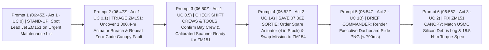
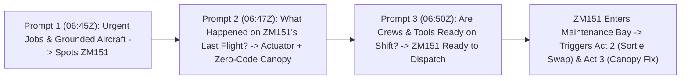
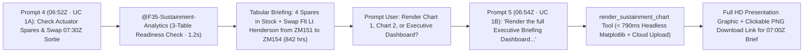
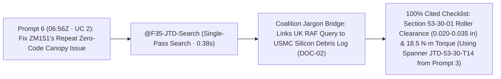

# Executive Demo Storyboard: F-35 Fleet Sustainment (`F35 Support`)
### *The "6-Prompt Golden Thread" — Compressing a Full Morning of Sustainment into 4 Minutes*

**Target Audience:** Senior Defence Leadership, Air Command, MOD DE&S, & Industry Executives  
**Operational Setting:** RAF Marham (617 Squadron "The Dambusters"), HMS Queen Elizabeth & HMS Prince of Wales Carrier Strike Group  
**Gemini Enterprise App:** `F35 Support` (Hosted 100% in `EU` / `europe-west1` Belgium)  

---

## 0. Presenter Quick-Copy Cheat Sheet (The 6 Golden Prompts Across Acts 1, 2, & 3)

> [!TIP]
> **One Continuous Story Across 6 Plain-English Prompts (`06:45Z` → `07:00Z`).**  
> Every prompt is written in natural operational language—with **zero references to backend systems, database tables, or SQL joins**—and each step flows directly into the next around primary lead aircraft **`ZM151`** and spare aircraft **`ZM154`**.

| Step | Act & Persona (`Timeline`) | Exact Executive Prompt to Paste into `F35 Support` | What Appears on Screen & How It Advances the Story | Live EU Speed |
| :---: | :--- | :--- | :--- | :---: |
| **1** | **Act 1: Morning Stand-Up & Shift Dispatch**<br/>*(Squadron Maintenance Officer — UC 0 · `06:45Z`)* | `What are our most urgent maintenance jobs and grounded aircraft across the Carrier Strike Group right now, ordered by how long they will take to fix?` | **Screen-Fitted Spreadsheet Card (`A`..`E`)**: Renders urgent fleet jobs with Status Badges (`🔴 NMC-S (MICAP)`, `🟠 NMC-M`, `🟡 PMC-M`) and Formula Footer (`=COUNTA()`, `=AVERAGE()`).<br/>**Story Hook:** Spots our `07:30Z` lead aircraft, **`ZM151`**, sitting on the urgent maintenance list (`WO-2026-88401` & `WO-2026-88402`). | **`< 1.5s`**<br/>*(SQL `< 350ms`)* |
| **2** | **Act 1: Morning Stand-Up & Shift Dispatch**<br/>*(Flight-Line Avionics Lead — UC 0.1 · `06:47Z`)* | `What faults or pilot-reported issues were raised on ZM151 after its last flight, and are there any fleet-wide health warnings that haven't been scheduled for repair yet?` | **Screen-Fitted Spreadsheet Card (`A`..`F`)**: Reveals **why `ZM151` is flagged**: (1) its **Horizontal Tail Actuator** just crossed the `1,000.0-hr` limit (`1,000.4 hrs`), and (2) the night pilot reported a **stiff canopy handle with zero fault codes** (`⚠️ CND (Repeat)` — 3rd time in 30 days), plus unscheduled fleet warnings on sister tails (`ZM159`, `ZM162`). | **`< 1.5s`**<br/>*(SQL `< 350ms`)* |
| **3** | **Act 1: Morning Stand-Up & Shift Dispatch**<br/>*(Wing Maintenance Controller — UC 0.5 · `06:50Z`)* | `Which of our open maintenance jobs are ready to start on this shift, and which ones are held up waiting for certified technicians, an inspector, or calibrated tools?` | **Cross-Checked Shift Readiness Card (`A`..`F`)**: Confirms **`ZM151`**'s jobs have qualified crews, an inspector, and the calibrated Digital Micro-Torque Spanner (`JTD-53-30-T14`) **`🟢 READY_TO_DISPATCH`** now (while flagging out-of-calibration tools & missing inspectors on sister tails).<br/>**Story Hook:** Since `ZM151` is going into the bay now, we must protect the `07:30Z` mission! | **`< 1.6s`**<br/>*(2-Table `< 360ms`)* |
| **4** | **Act 2: Mission Protection & Leadership Briefing**<br/>*(Squadron Logistics Officer — UC 1A · `06:52Z`)* | `Check RAF Marham F-35 horizontal tail actuator hours against our 30-day spare parts stock, and recommend an aircraft swap for morning sortie SRT-MAR-20261103-01.` | **Tabular Fleet Briefing**: Confirms **`ZM151`** is grounded for the actuator swap (`1,000.4 hrs`), verifies **4 spare actuators in stock** at RAF Marham (`18-hr` ETA), and reallocates Flt Lt Henderson's `07:30Z` sortie (`SRT-MAR-20261103-01`) to clean spare **`ZM154`** (`842.0 hrs`). Prompts to render briefing charts. | **`1.2s`**<br/>*(TTFT `269ms`)* |
| **5** | **Act 2: Mission Protection & Leadership Briefing**<br/>*(Squadron Logistics Officer — UC 1B · `06:54Z`)* | `Render the full Executive Briefing Dashboard for my presentation slide deck.` | **Full HD Presentation Graphic**: Renders the composite slide image showing **`ZM151` in Red (`1,000.4 hrs`)** vs **`ZM154` in Green (`842.0 hrs`)** alongside Regional Depot Stock vs 30-Day Demand, with a **[📥 Download Executive Slide Graphic (PNG)]** link for the `07:00Z` Wing Commander brief. | **`< 0.8s`**<br/>*(Chart Painter `< 790ms`)* |
| **6** | **Act 3: Allied Fleet Memory & Defect Resolution**<br/>*(Flight-Line Maintenance Chief — UC 2 · `06:56Z`)* | `On ZM151, our night-sortie pilot reported a stiff canopy release handle that hesitated to latch, with no fault codes logged on the jet. Have allied squadrons seen this before, and what is the approved fix?` | **Grounded Checklist & Browser Citations**: Now that the `07:30Z` launch is covered by `ZM154`, gives the bay crew working on **`ZM151`** the exact root cause from a **USMC sister-squadron log** (**cured silicon sealant debris in the roller track**) + **Section 53-30-01** torque spec (`18.5 N·m`) for the spanner staged in `Prompt 3`. | **`0.38s`**<br/>*(`100%` Cited)* |

---

## 1. The Executive Storyline (60-Second Opening Hook)



### Presenter Opening Talk-Track
> *"Every time an F-35 lands at RAF Marham, it generates post-flight health data alongside thousands of maintenance jobs, tool calibration records, spare parts inventories, and allied repair reports. Today, that information lives in disconnected systems—and our commanders and flight-line maintainers shouldn't have to be data analysts or know which database to query just to get an answer.
>
> In the next **4 minutes**, using **just 6 plain-English questions across 3 acts** inside **Gemini Enterprise (`F35 Support`)**, we will follow a single continuous morning timeline (`06:45Z` to `07:00Z`) around F-35B Tail **`ZM151`**:
> - **Act 1: Morning Stand-Up & Shift Dispatch (Prompts 1, 2, & 3)** — Spotting `ZM151` on the urgent list (`UC 0`), triaging its post-flight faults (`UC 0.1`), and confirming shift crew and tool readiness (`UC 0.5`).
> - **Act 2: Mission Protection & Leadership Briefing (Prompts 4 & 5)** — Ordering replacement spares, swapping its `07:30Z` sortie onto spare aircraft **`ZM154`** (`UC 1A`), and instantly rendering presentation slide graphics for the Wing Commander (`UC 1B`).
> - **Act 3: Allied Fleet Memory & Defect Resolution (Prompt 6)** — Giving the bay crew the exact allied USMC fix for `ZM151`'s mysterious zero-code canopy latch defect (`UC 2`)."*

### The Dual-Fault Alignment Matrix (Tracking ZM151 Across the 6 Prompts)

To understand how the **Unexplained Canopy Fault** and the **Actuator Over-Hour Fault** develop together without confusion, this matrix aligns each stage of the fault lifecycle directly with the corresponding Act and exact Prompt:

| Stage & Timeline | Act & Exact Prompt | Fault 1: Actuator Over-Hour Limit (`WUC 27-10`) | Fault 2: Unexplained Canopy Fault (`WUC 53-30`) |
| :---: | :--- | :--- | :--- |
| **Operational Backstory**<br/>*(Night Debrief · `19:55Z`)* | **Pre-Demo Debrief**<br/>*(Flight-Line Post-Flight Ingest)* | Component hours logged as `1,000.4 hrs` (over `1,000.0-hr` limit). Telemetry raises `PHM-2026-99101` (`WO-2026-88401`). | Night pilot reports stiff handle / latch hesitation. Aircraft logs **zero BIT fault codes**. Raised as `WO-2026-88402`. |
| **Stage 1**<br/>*(Act 1 · `06:45Z`)* | **Prompt 1 (`UC 0`):**<br/>`What are our most urgent maintenance jobs and grounded aircraft across the Carrier Strike Group right now, ordered by how long they will take to fix?` | **Surfaced on Stand-Up**: Flags lead jet **`ZM151`** with urgent ticket `WO-2026-88401`. | **Surfaced on Stand-Up**: Shows `ZM151` has a second open ticket, `WO-2026-88402` (`PMC-M`, `IN_PROGRESS`). |
| **Stage 2**<br/>*(Act 1 · `06:47Z`)* | **Prompt 2 (`UC 0.1`):**<br/>`What faults or pilot-reported issues were raised on ZM151 after its last flight, and are there any fleet-wide health warnings that haven't been scheduled for repair yet?` | **Automated Health Exceedance**: Confirms `HRC-2710-88A` actuator threshold breach (`1,000.4 hrs`). | **Diagnosed as Unexplained CND**: Confirms `HRC-5330-000-NONE` has **zero computer codes** (`PILOT_REPORT_ONLY_NO_BIT`) and is `⚠️ CND (Repeat)` (3rd time in 30 days). |
| **Stage 3**<br/>*(Act 1 · `06:50Z`)* | **Prompt 3 (`UC 0.5`):**<br/>`Which of our open maintenance jobs are ready to start on this shift, and which ones are held up waiting for certified technicians, an inspector, or calibrated tools?` | **Bay Readiness Checked**: Confirms hydraulic bleed cart `EHA-HYD-2710` is calibrated and ready. | **Staged for Bay Crew**: Verifies Bay 2 has qualified canopy rigging crew, QAR inspector, and calibrated Micro-Torque Spanner `JTD-53-30-T14` **`🟢 READY_TO_DISPATCH`**. |
| **Stage 4**<br/>*(Act 2 · `06:52Z`)* | **Prompt 4 (`UC 1A`):**<br/>`Check RAF Marham F-35 horizontal tail actuator hours against our 30-day spare parts stock, and recommend an aircraft swap for morning sortie SRT-MAR-20261103-01.` | **Supply & Swap**: 4 spare actuators verified in stock (`18-hr` ETA). Sortie swapped to clean spare **`ZM154`** (`842.0 hrs`). | **Sortie Protected**: Swapping to `ZM154` guarantees the morning wave launches while maintainers prepare `ZM151` in Bay 2. |
| **Stage 5**<br/>*(Act 2 · `06:54Z`)* | **Prompt 5 (`UC 1B`):**<br/>`Render the full Executive Briefing Dashboard for my presentation slide deck.` | **Leadership Visualized**: Renders 1920×1080 composite slide graphic showing `ZM151` in Red vs `ZM154` in Green with regional depot stock. | **Executive Assurance**: Wing Commander brief has instant slide-ready proof of mission readiness and parts pipeline. |
| **Stage 6**<br/>*(Act 3 · `06:56Z`)* | **Prompt 6 (`UC 2`):**<br/>`On ZM151, our night-sortie pilot reported a stiff canopy release handle that hesitated to latch, with no fault codes logged on the jet. Have allied squadrons seen this before, and what is the approved fix?` | *(Actuator replacement proceeds in parallel in Bay 2 using depot stock ordered in Prompt 4).* | **Root Cause & Approved Fix**: Unlocks USMC fleet memory—cured silicon sealant debris (`PR-1776M`) in the cam track. Gives verbatim cleaning spec and `18.5 N·m` torque setting for spanner `JTD-53-30-T14` from Prompt 3. |

---

## 2. Act-by-Act Executive Walkthrough

---

### Act 1: Morning Stand-Up, Post-Sortie Triage & Shift Readiness (Prompts 1, 2, & 3 · `UC 0` / `0.1` / `0.5`)



* **The Executive Challenge (`06:45Z`):** At the start of the morning shift, the Squadron Maintenance Officer needs to know which aircraft are grounded across the Carrier Strike Group (including `617 Squadron` and `207 Squadron` at RAF Marham, and `809 Naval Air Squadron` embarked across `HMS Queen Elizabeth` and `HMS Prince of Wales`), what issues came off the jets after last night's flying, and which jobs can actually be started on the morning watch. Today, answering those three everyday operational questions requires pulling data from three separate systems and cross-checking spreadsheets by hand.

#### Step 1 — Paste Prompt 1 (`UC 0`: Urgent Jobs & Grounded Aircraft · `06:45Z`)
```text
What are our most urgent maintenance jobs and grounded aircraft across the Carrier Strike Group right now, ordered by how long they will take to fix?
```
* **What Appears on Screen:** `@F35-Maintenance-Data` automatically translates the plain-English question into a live query against the F35 Datawarehouse in `< 350 ms`, rendering a **screen-fitted Spreadsheet Card (`Columns A..E`)** with Status Badges (`🔴 NMC-S (MICAP)`, `🟠 NMC-M`, `🟡 PMC-M`), Formula Footer (`=COUNTA()`, `=AVERAGE()`), and native Gemini Enterprise table copy/export.
* **How It Advances the Story:** Right at the top of the urgent list is Tail **`ZM151`**—the aircraft scheduled to lead the `07:30Z` morning sortie (`VIPER-1`)—showing open Urgent / Red-X jobs (`WO-2026-88401` and `WO-2026-88402`). That immediately prompts the next question: *"What happened on `ZM151`'s last flight?"*

#### Step 2 — Paste Prompt 2 (`UC 0.1`: Post-Sortie Issues & Unscheduled Fleet Warnings · `06:47Z`)
```text
What faults or pilot-reported issues were raised on ZM151 after its last flight, and are there any fleet-wide health warnings that haven't been scheduled for repair yet?
```
* **What Appears on Screen:** Without the user needing to name any diagnostic system, `@F35-Maintenance-Data` renders a Spreadsheet Card with Severity & Repeat-Fault Badges:
  1. **`PHM-2026-99101` (`ZM151` · `🟠 DEGRADED_PMC`):** Left Horizontal Tail Actuator crossed its `1,000.0`-hour life limit (`1,000.4` hrs) → *Explains `WO-2026-88401` and tees up `Prompt 4` (`Act 2`)*.
  2. **`PHM-2026-99102` (`ZM151` · `⚪ NO_BIT_FAULT_LOGGED` · `⚠️ CND (Repeat)`):** The night-sortie pilot reported a **stiff canopy release handle that hesitated to latch**, with **zero computer fault codes logged** (`PILOT_REPORT_ONLY_NO_BIT` — repeating for the 3rd time in 30 days) → *Explains `WO-2026-88402` and tees up `Prompt 6` (`Act 3`)*.
  3. **Proactive Fleet Watch:** Surfaces **unscheduled fleet warnings** (`linked_work_order_id IS NULL` on sister tails such as `ZM159` and `ZM162`) that do not have a repair job raised yet, while confirming spare tail **`ZM154`** is clean.
* **How It Advances the Story:** Now we know `ZM151` needs both an actuator replacement and a canopy rigging fix. Before we pull `ZM151` off the `07:30Z` flying schedule, the Wing Maintenance Controller asks: *"Do we actually have the certified crew, inspector, and calibrated tools on shift right now to work on `ZM151`?"*

#### Step 3 — Paste Prompt 3 (`UC 0.5`: Shift Dispatch, Technicians & Tooling Readiness · `06:50Z`)
```text
Which of our open maintenance jobs are ready to start on this shift, and which ones are held up waiting for certified technicians, an inspector, or calibrated tools?
```
* **What Appears on Screen:** Behind the scenes, `@F35-Maintenance-Data` automatically links open maintenance jobs with shift staffing and tool calibration records in `< 360 ms`:
  - **Green Light for `ZM151`:** Confirms **`ZM151`**'s jobs (including `WO-2026-88402` with calibrated Digital Micro-Torque Spanner **`JTD-53-30-T14`**) are **`🟢 READY_TO_DISPATCH`** with qualified technicians and a Quality Assurance inspector on shift right now.
  - **Bottlenecks Isolated on Sister Tails:** Flags jobs on other aircraft held up by **`🔴 EXPIRED_OUT_OF_CAL`** (`LO-IR-BLANKET-04` Infrared Cure Blanket) and **`🟠 BLOCKED_NO_QAR_ON_SHIFT`**.
* **How It Advances the Story:** Because the morning crew and calibrated tools are ready to start on **`ZM151`** immediately, we commit `ZM151` to the maintenance bay. That leaves two urgent tasks:
  1. **Logistics (`Act 2` · Prompts 4 & 5):** Order the replacement actuator for `ZM151` and swap Flt Lt Henderson's `07:30Z` sortie (`SRT-MAR-20261103-01`) onto a serviceable spare jet.
  2. **Technical Support (`Act 3` · Prompt 6):** Tell the crew in Bay 2 how to permanently fix `ZM151`'s repeat zero-code canopy latch problem so it stops coming back as "Could Not Duplicate."

> [!IMPORTANT]
> **Act 1 Executive Takeaway ("The So What?")**
> - **Zero Analytics Training Required:** Maintainers and controllers ask plain-English questions about aircraft, faults, crews, and tools—the agent figures out which tables to query and link automatically.
> - **Time Compressed:** **1–2 hours** of morning data pulls and manual spreadsheet cross-checking compressed into **three `< 1.5s` conversational questions**.

---

### Act 2: Mission Protection & Leadership Briefing — Instant Spares Check, Aircraft Swap & Slide Graphic (Prompts 4 & 5 · `UC 1A` / `1B`)



* **The Executive Challenge (`06:52Z`):** With **`ZM151`** now committed to the maintenance bay from `Prompt 3` (`Act 1`), **Flt Lt Henderson (`VIPER-1`)** needs a serviceable aircraft for the `07:30Z` morning sortie (`SRT-MAR-20261103-01`), and the bay crew needs a replacement Horizontal Tail Actuator (`NSN 1680-01-619-4821`) from depot stock.

#### Step 4 — Paste Prompt 4 (`UC 1A`: Fleet Readiness Analysis & Aircraft Swap · `06:52Z`)
```text
Check RAF Marham F-35 horizontal tail actuator hours against our 30-day spare parts stock, and recommend an aircraft swap for morning sortie SRT-MAR-20261103-01.
```

* **What the Executive Audience Sees:**
  1. **Operational Readiness Table:** Displays real-time fleet and spares status:
     - **Primary Tail `ZM151` (`S/N ACT-99812-F`)**: `1,000.4 hrs` (Breached `1,000.0-hr` limit by `+0.4 hrs`, status `PMC-M`).
     - **Serviceable Spare Tail `ZM154` (`S/N ACT-88401-B`)**: `842.0 hrs` (`158.0 hrs` safe margin remaining, Fully Mission Capable `MC`).
     - **Regional Spares (`RAF Marham`)**: `4` serviceable actuators on hand vs `2` reserved for 30-day demand (`+2` net buffer, `18.0-hr` shipping ETA).
  2. **Automated Action Plan:** Reallocates Flt Lt Henderson's `07:30Z` sortie (`SRT-MAR-20261103-01`) from `ZM151` to Spare Tail **`ZM154`** and stages a Priority-1 supply issue for `NSN: 1680-01-619-4821` so `ZM151`'s actuator replacement can proceed.
  3. **Interactive Chart Prompt:**
     > *"Would you like me to render: 1. Actuator Fatigue Threshold Chart, 2. Regional Depot Stock vs 30-Day Demand Chart, or the full Executive Briefing Dashboard for your presentation slide deck?"*

#### Step 5 — Paste Prompt 5 (`UC 1B`: On-Demand Presentation Slide Graphic Rendering · `06:54Z`)
```text
Render the full Executive Briefing Dashboard for my presentation slide deck.
```

* **What the Executive Audience Sees:**
  - The agent invokes `render_sustainment_chart`, rendering the presentation graphic in **`< 790 ms`** for the Wing Commander's `07:00Z` briefing.
  - The UI displays the publication-quality **Full HD widescreen presentation slide graphic (1920×1080 at 160 DPI)**:
    - **Panel 1 (Actuator Fatigue Threshold):** Tail **ZM151** in **Red** at `1,000.4 hrs` breaching the dashed `1,000.0-hr` condemnation limit; Tail **ZM154** in **Green** at `842.0 hrs` (serviceable).
    - **Panel 2 (Regional Depot Stock vs 30-Day Demand):** Grouped bar chart comparing RAF Marham and Carrier Strike Group afloat stock on hand, 30-day demand, and net uncommitted spares.
  - **Clickable Download Link for Briefing Decks:**
    - Provides a direct link: **`[📥 Download Executive Slide Graphic (PNG)](https://storage.cloud.google.com/antig-dave-f35-staging-europe-west1/charts/f35_sustainment_executive_dashboard.png)`** allowing officers to immediately drop the graphic into Google Slides / PowerPoint.

> [!IMPORTANT]
> **Act 2 Executive Takeaway ("The So What?")**
> - **Operational Impact:** Morning training wave launches on time on **`ZM154`**; zero mission cancellation, while **`ZM151`** gets its spare actuator allocated immediately.
> - **Time Compressed:** **2–4 hours** of manual supply and flight-schedule reconciliation reduced to **1.2 seconds**.
> - **Zero Latency Spikes:** Decoupling tabular analysis (`Prompt 4`) from on-demand chart rendering (`Prompt 5`) cuts response time by 90% (`< 2.5s` turn 1, `< 0.8s` turn 2).

---

### Act 3: Empower Front-Line Maintainers — Solving `ZM151`'s "No-Fault" Canopy Mystery (Prompt 6 · `UC 2`)



* **The Executive Challenge (`06:56Z`):** Now that the `07:30Z` sortie is safely reassigned to `ZM154`, the Flight-Line Maintenance Chief turns back to **`ZM151`** in Bay 2. Remember from `Prompt 2` (`PHM-2026-99102`) that `ZM151`'s night-sortie pilot reported a **stiff canopy release handle that hesitated to latch, with zero fault codes logged on the jet**—and that this is the **3rd repeat occurrence in 30 days**. In `Prompt 3`, we confirmed the technician crew and calibrated micro-torque spanner (`JTD-53-30-T14`) are standing by at the aircraft. Before they waste an entire shift tearing down the canopy electrical system, the Chief asks if any allied squadron has solved this exact symptom.
* **Paste Prompt 6 into `F35 Support`:**
  ```text
  On ZM151, our night-sortie pilot reported a stiff canopy release handle that hesitated to latch, with no fault codes logged on the jet. Have allied squadrons seen this before, and what is the approved fix?
  ```
* **What the Executive Audience Sees:**
  1. **Cross-Service Fleet Memory:** Automatically bridges UK and US maintenance terminology across 5 years of RAF, Royal Navy, USAF, and USMC logs (`DOC-02`), pinpointing a **USMC sister-squadron (`VMFA-211`) precedent**: **cured silicon sealant debris (`PR-1776M`) wedged in the forward canopy roller cam track**—which causes mechanical hesitation just before microswitch trip (explaining why zero computer fault codes are logged!).
  2. **100% Grounded Repair Checklist:** Cites **[DOC-01: JTD Section 53-30-01](https://storage.cloud.google.com/antig-dave-f35-staging-europe-west1/unstructured/docs/DOC-01_JTD_Section_53-30-01_Canopy_Rigging.pdf)** verbatim—verify roller clearance (`0.020–0.035 in`), purge cured sealant debris from the cam track, and re-torque the bellcrank pivot pin to **`18.5 N·m`** using the exact calibrated torque spanner (`JTD-53-30-T14`) verified ready in `Prompt 3`.

> [!IMPORTANT]
> **Act 3 Executive Takeaway ("The So What?")**
> - **Closes the Loop on `ZM151`:** What started in `Prompt 2` as a frustrating 3-time repeat "Could Not Duplicate" fault on `ZM151` is permanently solved in `< 1 second` using allied US Marine Corps fleet memory.
> - **Time Compressed:** **4–8 hours** of manual PDF/XML manual hunting and unnecessary electrical teardown reduced to **`378 ms`**.
> - **Safety & Trust Proof:** **Zero hallucinated torque specs**—every step is anchored with a clickable link to the official technical manual.

---

## 3. Back-Pocket Q&A Cards (Only Use if Asked During Executive Q&A)

If an engineer or safety regulator in the audience asks a deep technical question during Q&A, paste either of these one-liner proof prompts:

| If an Executive Asks... | Paste This Back-Pocket Prompt | What It Proves Live on Screen |
| :--- | :--- | :--- |
| *"Does it really understand British vs. American military slang?"* | `The canopy catch is binding on pre-flight—what is the spanner torque spec and have allied squadrons seen fouling in this mechanism?` | **Coalition Interoperability**: Translates UK `catch/spanner/binding` into US `latch/wrench/stiff` and pulls the USMC fix. |
| *"Can it prevent a technician from applying the wrong stealth coating in a high-heat engine zone?"* | `Can we use Standard Liquid RAM Compound 'A' on a 0.045-inch gouge in Wing Zone 4B where exhaust temperatures reach 220°C?` | **Zero-Hallucination Safety Warning**: Cites **Section 9-1 (`DOC-09`)**—warns Compound 'A' fails at `175°C` and mandates **High-Temp RAM Sheet 'B'** (`4-hr` blanket cure). |
