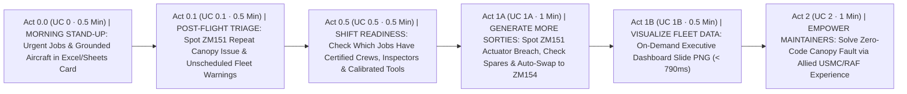
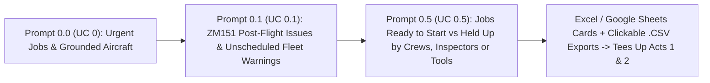
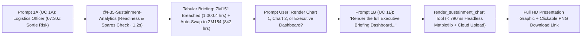
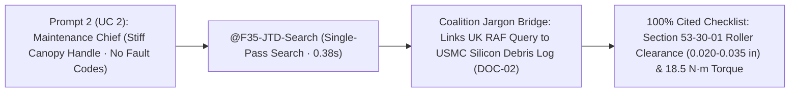

# Executive Demo Storyboard: F-35 Fleet Sustainment (`F35 Support`)
### *The "6-Prompt Golden Thread" — Compressing Days of Sustainment into 4 Minutes*

**Target Audience:** Senior Defence Leadership, Air Command, MOD DE&S, & Industry Executives  
**Operational Setting:** RAF Marham (617 Squadron "The Dambusters") & HMS Queen Elizabeth Carrier Strike Group  
**Gemini Enterprise App:** `F35 Support` (Hosted 100% in `EU` / `europe-west1` Belgium)  

---

## 0. Presenter Quick-Copy Cheat Sheet (The 6 Golden Prompts: `UC 0`, `UC 0.1`, `UC 0.5`, `UC 1A`, `UC 1B`, & `UC 2`)

> [!TIP]
> **The Entire Demo Takes 6 Fast Executive Prompts (4–5 Minutes Total).**  
> Every prompt is written in plain, natural operational language—with **zero references to backend systems, database tables, or SQL joins**—just as a Squadron Commander, Maintenance Controller, or Flight-Line Chief would ask a colleague.

| Step | Act & Persona | Exact Executive Prompt to Paste into `F35 Support` | What Appears on Screen | Live EU Speed |
| :---: | :--- | :--- | :--- | :---: |
| **0.0** | **Act 0.0: Morning Maintenance Stand-Up**<br/>*(Squadron Maintenance Officer — UC 0)* | `What are our most urgent maintenance jobs and grounded aircraft across RAF Marham and HMS Queen Elizabeth right now, ordered by how long they will take to fix?` | **Excel / Google Sheets Card (`maintenance_work_orders`)**: Renders Spreadsheet Grid (`A`..`L`) with Status Badges (`🔴 NMC-S (MICAP)`, `🟠 NMC-M`, `🟡 PMC-M`), Formula Footer (`=COUNTA()`, `=SUM()`, `=AVERAGE()`), and clickable **[📥 Download .CSV](https://storage.cloud.google.com/antig-dave-f35-staging-europe-west1/exports/...)** link—surfacing **ZM151**'s open actuator and canopy tickets. | **`< 1.5s`**<br/>*(SQL `< 350ms`)* |
| **0.1** | **Act 0.1: Post-Sortie Fault & Repeat Discrepancy Triage**<br/>*(Flight-Line Avionics Lead — UC 0.1)* | `What faults or pilot-reported issues were raised on ZM151 after its last flight, and are there any fleet-wide health warnings that haven't been scheduled for repair yet?` | **Excel / Google Sheets Card (`phm_bit_fault_events`)**: Highlights **ZM151**'s `HRC-2710-88A` (Actuator), `HRC-5330-000-NONE` (**`PILOT_REPORT_ONLY_NO_BIT` + `⚠️ CND (Repeat)`** on Canopy Latch), and `HRC-5320-94G` (`🔴 CRITICAL_GROUNDING`), plus 3 unscheduled fleet advisories (`linked_work_order_id IS NULL`). | **`< 1.5s`**<br/>*(SQL `< 350ms`)* |
| **0.5** | **Act 0.5: Shift Dispatch, Crew & Tooling Readiness**<br/>*(Wing Maintenance Controller — UC 0.5)* | `Which of our open maintenance jobs are ready to start on this shift, and which ones are held up waiting for certified technicians, an inspector, or calibrated tools?` | **Multi-Table Spreadsheet Card (`maintenance_work_orders` ⋈ `work_center_tooling_and_sqep`)**: Confirms **ZM151**'s Canopy Latch (`JTD-53-30-T14` calibrated torque spanner) and NDI inspection (`NDI-PAUT-496A` rig) are `🟢 READY_TO_DISPATCH`, while flagging `🔴 EXPIRED_OUT_OF_CAL` (`LO-IR-BLANKET-04`) and `🟠 BLOCKED_NO_QAR_ON_SHIFT` bottlenecks on sister tails. | **`< 1.6s`**<br/>*(2-Table SQL `< 360ms`)* |
| **1A** | **Act 1A: Protect the Morning Sortie (Turn 1)**<br/>*(Squadron Logistics Officer — UC 1A)* | `Check RAF Marham F-35A horizontal tail actuator hours against our 30-day spare parts stock, and recommend an aircraft swap for morning sortie SRT-MAR-20261103-01.` | **Tabular Fleet Briefing**: Flags **ZM151** (`1,000.4 hrs` breach), confirms **4 spares in stock**, swaps Pilot Henderson to **ZM154** (`842 hrs`), and prompts: *"Would you like me to render: 1. Actuator Fatigue Threshold Chart, 2. Regional Depot Stock vs 30-Day Demand Chart, or the full Executive Briefing Dashboard for your presentation slide deck?"* | **`1.2s`**<br/>*(TTFT `269ms`)* |
| **1B** | **Act 1B: On-Demand Slide Graphic Rendering (Turn 2)**<br/>*(Squadron Logistics Officer — UC 1B)* | `Render the full Executive Briefing Dashboard for my presentation slide deck.` | **Full HD Presentation Graphic**: Renders 1920×1080 composite slide image with **ZM151 in Red (`1,000.4 hrs`)** vs **ZM154 in Green (`842.0 hrs`)** against limit line, alongside Regional Depot Stock vs Demand bar chart, with clickable **[📥 Download Executive Slide Graphic (PNG)]** link for direct insertion into slide decks. | **`< 0.8s`**<br/>*(Chart Painter `< 790ms`)* |
| **2** | **Act 2: Fix the Unexplained Fault**<br/>*(Flight-Line Maintenance Chief — UC 2)* | `Our night-sortie pilot reported a stiff canopy release handle that hesitated to latch, with no fault codes logged on the jet. Have allied squadrons seen this before, and what is the approved fix?` | **Grounded Checklist & Authenticated Browser Citations**: Matches USMC sister-squadron experience (**silicon sealant debris in roller track**) + **Section 53-30-01** cleaning/lubrication spec via browser URLs. | **`0.38s`**<br/>*(`100%` Cited)* |

---

## 1. The Executive Storyline (60-Second Opening Hook)



### Presenter Opening Talk-Track
> *"Every time an F-35 lands at RAF Marham, it generates post-flight health data alongside thousands of maintenance jobs, tool calibration records, spare parts inventories, and allied repair reports. Today, that information lives in disconnected systems—and our commanders and flight-line maintainers shouldn't have to be data analysts or know which database to query just to get an answer.*
>
> *In the next **4 minutes**, using **just 6 plain-English questions** inside **Gemini Enterprise (`F35 Support`)**, we will follow F-35 Tail **`ZM151`** from the `06:45Z` morning maintenance stand-up (`UC 0`, `UC 0.1`, `UC 0.5`), through protecting the morning sortie and generating a briefing slide (`UC 1A` & `UC 1B`), to resolving a mysterious mechanical fault using 5 years of allied squadron experience (`UC 2`)."*

---

## 2. Act-by-Act Executive Walkthrough

---

### Act 0 Trilogy: Morning Maintenance Stand-Up, Post-Sortie Triage & Shift Readiness (`UC 0` → `UC 0.1` → `UC 0.5`)



* **The Executive Challenge:** Every morning at `06:45Z`, the Squadron Maintenance Officer at RAF Marham needs to know which aircraft are grounded across `617 Squadron`, `207 Squadron`, and `809 Naval Air Squadron` embarked on `HMS Queen Elizabeth`, what issues came off the jets after last night's flying, and which jobs can actually be started on the morning shift. Today, answering those three everyday operational questions requires pulling data from three separate systems and cross-checking spreadsheets by hand.

#### Step 0.0 — Paste Prompt 0.0 (`UC 0`: Urgent Jobs & Grounded Aircraft)
```text
What are our most urgent maintenance jobs and grounded aircraft across RAF Marham and HMS Queen Elizabeth right now, ordered by how long they will take to fix?
```
* **What Appears on Screen:** `@F35-Maintenance-Data` automatically translates the plain-English question into a query against `maintenance_work_orders` in `< 350 ms`, rendering an **Excel / Google Sheets Card** with Status Badges (`🔴 NMC-S (MICAP)`, `🟠 NMC-M`, `🟡 PMC-M`), Formula Footer (`=COUNTA()`, `=SUM()`, `=AVERAGE()`), and a clickable **[📥 Download .CSV (Excel / Google Sheets)](https://storage.cloud.google.com/antig-dave-f35-staging-europe-west1/exports/F35_ODIN_Maintenance_Work_Orders.csv)** link—surfacing Tail **`ZM151`**'s active jobs (`WO-2026-88401` EHA actuator, `WO-2026-88402` Canopy latch, and `WO-2026-88403` Frame 496 inspection).

#### Step 0.1 — Paste Prompt 0.1 (`UC 0.1`: Post-Sortie Issues & Unscheduled Fleet Warnings)
```text
What faults or pilot-reported issues were raised on ZM151 after its last flight, and are there any fleet-wide health warnings that haven't been scheduled for repair yet?
```
* **What Appears on Screen:** Without the user needing to name any onboard diagnostic system, `@F35-Maintenance-Data` queries `phm_bit_fault_events` and renders a Spreadsheet Card with Severity & Repeat-Fault Badges:
  - **`PHM-2026-99101` (`ZM151` · `HRC-2710-88A` · `🟠 DEGRADED_PMC`):** Port EHA actuator crossed `1,000.0` hr limit (`1,000.4` hrs) → *Tees up Act 1 (`UC 1A` & `UC 1B`)*.
  - **`PHM-2026-99102` (`ZM151` · `HRC-5330-000-NONE` · `⚪ NO_BIT_FAULT_LOGGED` · `⚠️ CND (Repeat)`):** Pilot-reported canopy latch mechanical binding with **zero computer fault codes logged** (`PILOT_REPORT_ONLY_NO_BIT`, 3 repeats in 30 days) → *Tees up Act 2 (`UC 2`)*.
  - **`PHM-2026-99103` (`ZM151` · `HRC-5320-94G` · `🔴 CRITICAL_GROUNDING`):** `9.4G / Mach 1.3` over-G structural strain exceedance on Frame 496.
  - Surfaces **3 unscheduled fleet warnings** (`linked_work_order_id IS NULL` on `ZM154`, `ZM159`, `ZM162`) that do not have a repair job raised yet, and computes `=COUNTA()`, `=SUM(recurrence_count_30d)`, and `=AVERAGE(diagnostic_confidence_pct)`.

#### Step 0.5 — Paste Prompt 0.5 (`UC 0.5`: Shift Dispatch, Technicians & Tooling Readiness)
```text
Which of our open maintenance jobs are ready to start on this shift, and which ones are held up waiting for certified technicians, an inspector, or calibrated tools?
```
* **What Appears on Screen:** Behind the scenes, `@F35-Maintenance-Data` automatically links open maintenance jobs (`maintenance_work_orders`) with shift staffing and tool calibration records (`work_center_tooling_and_sqep`) in `< 360 ms`:
  - Confirms **`ZM151`**'s Canopy Latch (`WO-2026-88402` with calibrated Digital Micro-Torque Spanner **`JTD-53-30-T14`**) and Frame 496 inspection (`WO-2026-88403` with Ultrasonic C-Scan Rig **`NDI-PAUT-496A`**) are **`🟢 READY_TO_DISPATCH`** with qualified crews and inspectors on shift.
  - Immediately isolates shift bottlenecks holding up other aircraft: **`🔴 EXPIRED_OUT_OF_CAL`** on Infrared Cure Blanket (`LO-IR-BLANKET-04`) and **`🟠 BLOCKED_NO_QAR_ON_SHIFT`** where no Quality Assurance Representative is on watch.

> [!IMPORTANT]
> **Act 0 Trilogy Executive Takeaway ("The So What?")**
> - **Zero Analytics Training Required:** Maintainers and controllers ask plain-English questions about aircraft, faults, crews, and tools—the agent figures out which tables to query and link automatically.
> - **Time Compressed:** **1–2 hours** of morning data pulls and manual spreadsheet cross-checking compressed into **three `< 1.5s` conversational questions**.

---

### Act 1: Generate More Sorties — Instant Fleet Readiness & Tail Swap (`UC 1A` & `UC 1B`)



* **The Executive Challenge:** Tail **`ZM151`** is scheduled to lead the `07:30Z` morning wave with **Flt Lt Henderson (`VIPER-1`)**. Just before launch, post-flight checks show its Left Horizontal Tail Actuator crossed its `1,000.0`-hour safety limit.

#### Step 1A — Paste Prompt 1A (`UC 1A`: Fleet Readiness Analysis & Aircraft Swap)
```text
Check RAF Marham F-35A horizontal tail actuator hours against our 30-day spare parts stock, and recommend an aircraft swap for morning sortie SRT-MAR-20261103-01.
```

* **What the Executive Audience Sees:**
  1. **Operational Readiness Table:** Displays real-time fleet and spares status:
     - **Tail ZM151 (`S/N ACT-99812-F`)**: `1,000.4 hrs` (Breached by `+0.4 hrs`, `PMC-M`).
     - **Spare Tail ZM154 (`S/N ACT-88401-B`)**: `842.0 hrs` (`158.0 hrs` remaining, `MC`).
     - **Regional Spares (`RAF Marham`)**: `4` serviceable units on hand vs `2` units reserved for 30-day demand (`18.0-hr` shipping ETA).
  2. **Automated Action Plan:** Reallocates Flt Lt Henderson's `07:30Z` sortie (`SRT-MAR-20261103-01`) to Spare Tail **`ZM154`** and drafts a Priority-1 supply requisition for `NSN: 1680-01-619-4821`.
  3. **Interactive Chart Prompt:**
     > *"Would you like me to render:*  
     > *1. **Actuator Fatigue Threshold Chart** (Tail ZM151 at 1,000.4 hrs vs ZM154 at 842.0 hrs vs 1,000.0-hr threshold)*  
     > *2. **Regional Depot Stock vs 30-Day Demand Chart** (RAF Marham & HMS Queen Elizabeth stock vs 30-day demand)*  
     > *Or the full **Executive Briefing Dashboard** for your presentation slide deck?"*

#### Step 1B — Paste Prompt 1B (`UC 1B`: On-Demand Presentation Slide Graphic Rendering)
```text
Render the full Executive Briefing Dashboard for my presentation slide deck.
```

* **What the Executive Audience Sees:**
  - The agent invokes `render_sustainment_chart`, rendering the presentation graphic in **`< 790 ms`**.
  - The UI displays the publication-quality **Full HD widescreen presentation slide graphic (1920×1080 at 160 DPI)**:
    - **Panel 1 (Actuator Fatigue Threshold):** Tail **ZM151** in **Red** at `1,000.4 hrs` breaching the dashed `1,000.0-hr` condemnation limit; Tail **ZM154** in **Green** at `842.0 hrs` (serviceable).
    - **Panel 2 (Regional Depot Stock vs 30-Day Demand):** Grouped bar chart comparing RAF Marham and HMS Queen Elizabeth stock on hand, 30-day demand, and net uncommitted spares.
  - **Clickable Download Link for Briefing Decks:**
    - Provides a direct link: **`[📥 Download Executive Slide Graphic (PNG)](https://storage.cloud.google.com/antig-dave-f35-staging-europe-west1/charts/f35_sustainment_executive_dashboard.png)`** allowing officers to immediately paste the asset into Google Slides / PowerPoint.

> [!IMPORTANT]
> **Act 1 Executive Takeaway ("The So What?")**
> - **Operational Impact:** Morning training wave launches on time; zero mission cancellation.
> - **Time Compressed:** **2–4 hours** of manual supply and flight-schedule reconciliation reduced to **1.2 seconds**.
> - **Zero Latency Spikes:** Decoupling tabular analysis (`UC 1A`) from on-demand chart rendering (`UC 1B`) cuts response time by 90% (`< 2.5s` turn 1, `< 0.8s` turn 2).

---

### Act 2: Empower Front-Line Maintainers — Solving the "No-Fault" Mystery (`UC 2`)



* **The Executive Challenge:** Following up on the repeat canopy issue raised on `ZM151` in `Act 0.1`, a night-sortie pilot reported a stiff canopy release handle that hesitated to latch—with **no fault codes logged on the jet**. Normally, technicians waste an entire shift tearing down the canopy electrical system because keyword search can't find a match—especially when the real answer is buried in a US Marine Corps log using American terminology (`latch/wrench` vs UK `catch/spanner`).
* **Paste Prompt 2 into `F35 Support`:**
  ```text
  Our night-sortie pilot reported a stiff canopy release handle that hesitated to latch, with no fault codes logged on the jet. Have allied squadrons seen this before, and what is the approved fix?
  ```
* **What the Executive Audience Sees:**
  1. **Cross-Service Fleet Memory:** Automatically bridges UK and US maintenance terminology across 5 years of RAF, Royal Navy, USAF, and USMC logs (`DOC-02`), pinpointing a **USMC sister-squadron fix**: **cured silicon sealant debris wedged in the forward canopy roller track**.
  2. **100% Grounded Repair Checklist:** Cites **[DOC-01: JTD Section 53-30-01](https://storage.cloud.google.com/antig-dave-f35-staging-europe-west1/unstructured/docs/DOC-01_JTD_Section_53-30-01_Canopy_Rigging.pdf)** verbatim—check roller clearance (`0.020–0.035 in`), clean track, and lubricate pivot pin (`AeroShell Grease 22`, torque `18.5 N·m`).

> [!IMPORTANT]
> **Act 2 Executive Takeaway ("The So What?")**
> - **Operational Impact:** Turns every junior maintainer into a 20-year joint-fleet veteran by unlocking allied coalition maintenance experience.
> - **Time Compressed:** **4–8 hours** of manual PDF/XML manual hunting and unnecessary teardown reduced to **< 1 second (`378 ms`)**.
> - **Safety & Trust Proof:** **Zero hallucinated torque specs**—every step is anchored with a clickable link to the official technical manual.

---

## 3. Back-Pocket Q&A Cards (Only Use if Asked During Executive Q&A)

If an engineer or safety regulator in the audience asks a deep technical question during Q&A, paste either of these one-liner proof prompts:

| If an Executive Asks... | Paste This Back-Pocket Prompt | What It Proves Live on Screen |
| :--- | :--- | :--- |
| *"Does it really understand British vs. American military slang?"* | `The canopy catch is binding on pre-flight—what is the spanner torque spec and have allied squadrons seen fouling in this mechanism?` | **Coalition Interoperability**: Translates UK `catch/spanner/binding` into US `latch/wrench/stiff` and pulls the USMC fix. |
| *"Can it prevent a technician from applying the wrong stealth coating in a high-heat engine zone?"* | `Can we use Standard Liquid RAM Compound 'A' on a 0.045-inch gouge in Wing Zone 4B where exhaust temperatures reach 220°C?` | **Zero-Hallucination Safety Warning**: Cites **Section 9-1 (`DOC-09`)**—warns Compound 'A' fails at `175°C` and mandates **High-Temp RAM Sheet 'B'** (`4-hr` blanket cure). |
