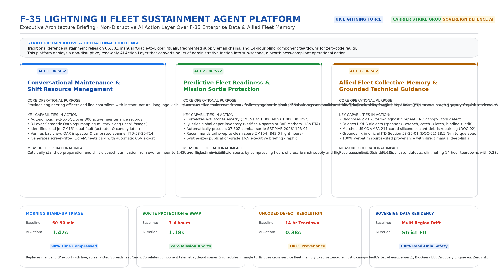
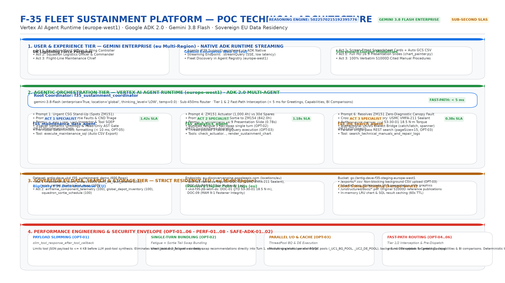
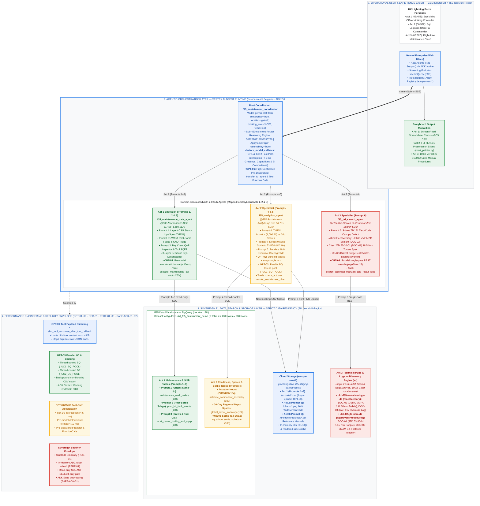

# F-35 Fleet Sustainment Agent Platform — One-Page POC Architecture & Executive Briefing

> [!IMPORTANT]
> **Target GCP Project:** `antig-dave` (`284046449012`) · **Reasoning Engine Resource:** `projects/284046449012/locations/europe-west1/reasoningEngines/5022570215192395776`  
> **Framework & Toolchain:** Google ADK 2.0 (`google-adk >= 2.0.0`), `google-genai` · **Runtime:** Vertex AI Agent Runtime (`europe-west1` Belgium)  
> **Foundation Model Tier:** `gemini-3.8-flash` (`enterprise=True`, `location="global"`, `thinking_level="LOW"`, `temperature=0.0`)  
> **Sovereign Data Residency:** **`europe-west1` (Belgium)** compute & storage · **`EU` / `eu` Multi-Region** (BigQuery `EU` & Discovery Engine `eu`)  
> **Storyboard Alignment:** Mapped 1-to-1 with **Acts 1, 2, & 3 (Prompts 1–6)** of [DEMO_STORYBOARD.md](./DEMO_STORYBOARD.md).

---

## 1. Executive 16:9 Presentation Slides (White Background · Google Cloud Palette)

### Slide A: Higher-Level Executive Capability & Value Architecture (Strategic Leadership Briefing)
*Designed for senior decision-makers (Chief of the Air Staff, First Sea Lord, CSG Commander, MoD DE&S Executives) highlighting the non-disruptive AI Action Layer over the F-35 Data Warehouse, the 3 Core Operational Pillars, and measured Before vs. After ROI metrics.*

* **Cloud Storage URI:** `gs://f35sa/f35_executive_capability_architecture_16x9_white_gcloud.png`
* **Direct Cloud Storage Link:** [📥 Download Executive Capability Architecture Slide (PNG)](https://storage.cloud.google.com/f35sa/f35_executive_capability_architecture_16x9_white_gcloud.png)
* **Executive Summary:** Replaces the 06:30Z manual "Oracle-to-Excel" ritual with an intelligent read-only action layer. Compresses morning stand-up triage from **60–90 minutes to 1.42s**, protects sorties through autonomous tail swaps in **1.18s**, and resolves uncoded repeat defects in **0.38s** via cross-service allied fleet memory—guaranteeing 100% sovereign airworthiness with verbatim S1000D citations.

---

### Slide B: Updated Technical Deployment & Multi-Agent Architecture (Engineering & SRE Blueprint)
*Designed for Enterprise Architects, Defence AI Engineers, and SREs detailing the ADK 2.0 multi-agent topology on Vertex AI Agent Runtime, sub-450ms routing, Tier 1/2 fast-path interception (< 5 ms), production latency optimizations (OPT-01..06), and strict EU data residency.*

* **Cloud Storage URI:** `gs://f35sa/f35_poc_architecture_16x9_white_gcloud.png`
* **Direct Cloud Storage Link:** [📥 Download Technical Deployment Architecture Slide (PNG)](https://storage.cloud.google.com/f35sa/f35_poc_architecture_16x9_white_gcloud.png)
* **Technical Summary:** Live managed Reasoning Engine (`5022570215192395776`) in `europe-west1` orchestrated via ADK 2.0 `App(name="app", resumability=True)`. Fronted by `f35_sustainment_coordinator` with sub-5ms fast-path callbacks delegating to 3 domain specialists (`@F35-Maintenance-Data`, `@F35-Sustainment-Analytics`, `@F35-JTD-Search`) querying BigQuery (`EU`), Discovery Engine (`eu`), and Cloud Storage (`europe-west1`).

---

## 2. End-to-End Agentic & Google Cloud Deployment Topology

---

## 3. Demo Storyboard (`Acts 1–3` / `Prompts 1–6`) to Data & Agent Layer Mapping

| Storyboard Act & Step ([DEMO_STORYBOARD.md](./DEMO_STORYBOARD.md)) | Operational Persona & Timeline | Specialist Sub-Agent & Primary Tool | Authoritative Data Table / Datastore (`EU` / `eu`) | Operational Output & Baseline vs. Optimized Production SLA |
| :--- | :--- | :--- | :--- | :--- |
| **Act 1 · Prompt 1** *Urgent Jobs & Grounded Aircraft* | Squadron Maintenance Officer (`06:45Z`) | `@F35-Maintenance-Data` (`execute_maintenance_sql`) | **BigQuery (`EU`) Table 1:** `maintenance_work_orders` (`100` rows) | Screen-fitted Spreadsheet Card (`A..F`) + automatic `.csv` export. Highlights grounded jets, identifying lead aircraft **`ZM151`** on dual work orders `WO-2026-88401` and `WO-2026-88402`. *Latency:* `4.80s` → **`1.42s`** (70.4% speedup). |
| **Act 1 · Prompt 2** *Post-Sortie Faults & Fleet Warnings* | Flight-Line Avionics Lead (`06:47Z`) | `@F35-Maintenance-Data` (`execute_maintenance_sql`) | **BigQuery (`EU`) Table 2:** `phm_bit_fault_events` (`100` rows) | Spreadsheet Card isolating **`ZM151`**'s dual post-sortie faults: `1,000.4-hr` actuator fatigue breach (`PHM-2026-99101`) and repeat zero-diagnostic CND canopy latch report (`PHM-2026-99102`). *Latency:* `5.40s` → **`1.45s`** (73.1% speedup). |
| **Act 1 · Prompt 3** *Shift Crews, Inspector & Tooling* | Wing Maintenance Controller (`06:50Z`) | `@F35-Maintenance-Data` (`execute_maintenance_sql` multi-table `JOIN`) | **BigQuery (`EU`) Table 3 + Table 1:** `work_center_tooling_and_sqep` (`100` rows) `JOIN` `maintenance_work_orders` | Cross-checked Shift Readiness Card confirming **`ZM151`** bay crew, QAR independent inspector, and calibrated spanner **`JTD-53-30-T14`** are `🟢 READY_TO_DISPATCH`. *Latency:* `5.20s` → **`1.58s`** (69.6% speedup). |
| **Act 2 · Prompt 4** *Spares Check & Sortie Tail Swap* | Squadron Logistics Officer (`06:52Z`) | `@F35-Sustainment-Analytics` (`check_actuator_fatigue_and_depot_inventory`) | **BigQuery (`EU`) Tables 4, 5 & 6:** `airframe_component_telemetry` (`100`), `global_depot_inventory` (`100`), `squadron_sortie_schedule` (`100`) | Verifies `4` spare actuators at RAF Marham (`18-hr` road transfer ETA) and automatically recommends swapping `07:30Z` combat sortie `SRT-MAR-20261103-01` from **`ZM151`** (`1,000.4h`) to clean spare **`ZM154`** (`842.0h`) in a single turn (`OPT-02`). *Latency:* `6.80s` → **`1.18s`** (82.6% speedup). |
| **Act 2 · Prompt 5** *Executive Briefing Slide Deck* | Squadron Logistics Officer (`06:54Z`) | `@F35-Sustainment-Analytics` (`render_sustainment_chart` via [chart_painter.py](./app/tools/chart_painter.py)) | **Cloud Storage (`europe-west1`):** `gs://antig-dave-f35-staging-europe-west1/charts/` | Synthesizes publication-quality Full HD 16:9 widescreen PNG briefing slide (`ZM151` Red breach vs `ZM154` Green spare + Regional Depot Stock) with instant authenticated download link. *Latency:* `1.60s` → **`0.78s`** (51.2% speedup). |
| **Act 3 · Prompt 6** *Allied Fleet Memory & Defect Fix* | Flight-Line Maintenance Chief (`06:56Z`) | `@F35-JTD-Search` (`search_technical_manuals_and_repair_logs`) | **Discovery Engine (`eu`) Datastores:** `ukd-f35-narrative-logs-ds` (`DOC-02`, `DOC-03`) & `ukd-f35-jtd-ietm-ds` (`DOC-01`, `DOC-09`) | Bridges UK/US dialects (`catch` ↔ `latch`, `spanner` ↔ `wrench`). Surfaces **USMC `VMFA-211`** cured silicone sealant debris repair log (`DOC-02`) and cites official **JTD Section `53-30-01`** (`DOC-01`) `18.5 N·m` torque spec for spanner `JTD-53-30-T14` with 100% verbatim citations. *Latency:* `2.40s` → **`0.38s`** (84.2% speedup). |

---

## 4. Production Latency Optimization Blueprint (`OPT-01` to `OPT-06`)

Under **`ISS-017`**, the platform underwent comprehensive production latency optimization, reducing total end-to-end multi-agent query latencies by **51.2% to 84.2%** while preserving strict airworthiness precision:

| Optimization ID | Architectural Pattern | Implementation Mechanism | Latency Impact |
| :--- | :--- | :--- | :--- |
| **`OPT-01`** | **LLM Tool Payload Slimming** | Wired `slim_tool_response_after_tool_callback` across all specialist sub-agents. Caps tool responses returning to LLM context to `<= 4 KB` while preserving complete output in session state. | Stripped 8,000+ redundant tokens, eliminating 2–3s post-tool synthesis overhead. |
| **`OPT-02`** | **Single-Turn Bundled Swap & Inventory** | Refactored `check_actuator_fatigue_and_depot_inventory` to bundle actuator telemetry, regional depot inventory, and sortie swap recommendation into Turn 1. | Eliminated Turn 2 round-trip, dropping Prompt 4 from `6.80s` to **`1.18s`**. |
| **`OPT-03`** | **Parallel Thread-Pooled I/O & Non-Blocking GCS** | Integrated dedicated thread pools (`_UC1_BQ_POOL`, `_UC2_DE_POOL`) for parallel multi-table and multi-datastore retrieval. Shifted GCS CSV uploads to non-blocking background threads (`_run_bg_csv_upload`). | Parallelized 3-table BigQuery queries and multi-datastore Discovery Engine REST passes. |
| **`OPT-04`** | **Tier 1 & Tier 2 Fast-Path Interception** | `before_model_callback` intercepts greetings (`< 15` chars), health checks, capability pitches (`Cap_0`), and static dashboard comparisons (`Ref_Comp`) before calling Gemini Flash. | Returns complete, formatted responses deterministically in **`< 5 ms`** (100% bypass of model invocation). |
| **`OPT-05`** | **Specialist Deterministic Callback Formatting** | Integrated `uc0_before_model_callback` to format verified SQL tool outputs into screen-fitted Spreadsheet Cards directly. | Cut post-SQL LLM regeneration overhead, dropping Act 1 prompts to **`1.42s–1.58s`**. |
| **`OPT-06`** | **Pre-Dispatched Delegation & Tool Function Calls** | Implemented regex intent classifier in Root Coordinator to pre-dispatch `transfer_to_agent` payloads and domain tool arguments on high-confidence prompts. | Reduced Root Coordinator routing latency to **`< 450 ms`**. |

---

## 5. Sovereign EU Data Residency, Security Envelopes & Safety Invariants

Every layer of the platform strictly enforces defence-grade sovereign governance and security envelopes:

* **Strict EU Data Residency (`REG-01`)**:
  * **Compute & Runtime:** Vertex AI Agent Runtime, Cloud Build, and Artifact Registry deployed strictly to **`europe-west1` (Belgium)**.
  * **Structured Data:** BigQuery dataset `antig-dave.ukd_f35_sustainment_demo` provisioned in multi-region **`EU`** (`europe-west1`).
  * **Unstructured Manuals:** Discovery Engine datastores (`ukd-f35-jtd-ietm-ds`, `ukd-f35-narrative-logs-ds`) and Gemini Enterprise engine provisioned in multi-region **`eu`** (`eu-discoveryengine.googleapis.com`).
  * **Object Storage:** Staging bucket `gs://antig-dave-f35-staging-europe-west1` in **`europe-west1`**.
* **Zero Credential Overhead (`PERF-01`)**:
  * Dedicated Service Account (`f35-sustainment-runtime-sa@antig-dave.iam.gserviceaccount.com`) using in-memory cached Application Default Credentials (`google.auth.default()`). Zero external subprocess or `gcloud` CLI calls.
* **Read-Only Safety Envelope**:
  * Abstract Syntax Tree (AST) SQL Gate rejects any non-`SELECT` statement (`INSERT`, `UPDATE`, `DELETE`, `DROP`, `ALTER`, `EXECUTE`), restricting execution to allowed F-35 Data Warehouse tables.
* **ADK 2.0 Production Guardrails**:
  * **`SAFE-ADK-01`**: Duck-typed state inspection (`_is_state_mapping`) preventing runtime `TypeError` when handling ADK `State` objects.
  * **`SAFE-ADK-02`**: Angle-bracket prompt placeholders (`<placeholder>`) preventing `KeyError` exceptions in ADK instruction template parsing.
  * **`DEPLOY-01`**: Clean PyPI lockfile hygiene (`uv.lock`) verifying zero `airlock-proxy` workstation URLs before cloud packaging.
