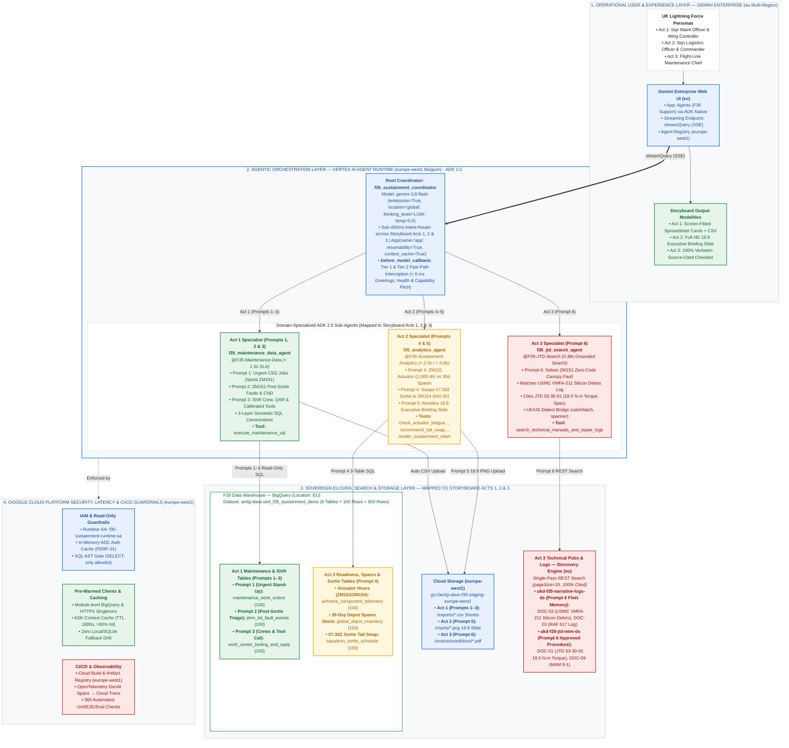

# F-35 Fleet Sustainment Agent Platform — One-Page POC Architecture

> [!IMPORTANT]
> **Target GCP Project:** `antig-dave` (`284046449012`) · **Framework:** Google ADK 2.0 (`google-adk >= 2.0.0`) · **Model Tier:** `gemini-3.8-flash` (`enterprise=True`, `thinking_level="LOW"`, `temperature=0.0`) · **Sovereign Data Residency:** **`europe-west1` (Belgium)** & **`EU` / `eu` Multi-Region** · **Storyboard Alignment:** Mapped 1-to-1 with **Acts 1, 2, & 3 (Prompts 1–6)** of [DEMO_STORYBOARD.md](./DEMO_STORYBOARD.md).

---

## 1. Executive 16:9 Presentation Slide (White Background · Google Cloud Palette)

* **Cloud Storage URI:** `gs://f35sa/f35_poc_architecture_16x9_white_gcloud.png`
* **Direct Cloud Storage Link:** [📥 Download 16:9 POC Architecture Slide (PNG)](https://storage.cloud.google.com/f35sa/f35_poc_architecture_16x9_white_gcloud.png)

---

## 2. End-to-End Agentic & Google Cloud Deployment Topology

---

## 3. Demo Storyboard (`Acts 1–3` / `Prompts 1–6`) to Data & Agent Layer Mapping

| Storyboard Act & Step ([DEMO_STORYBOARD.md](./DEMO_STORYBOARD.md)) | Operational Persona & Timeline | Specialist Sub-Agent & Tool | Authoritative Data Table / Datastore (`EU` / `eu`) | Operational Output & SLA |
| :--- | :--- | :--- | :--- | :--- |
| **Act 1 · Prompt 1** *Urgent Jobs & Grounded Aircraft* | Squadron Maintenance Officer (`06:45Z`) | `@F35-Maintenance-Data` (`execute_maintenance_sql`) | **BigQuery (`EU`) Table 1:** `maintenance_work_orders` (`100` rows) | Screen-fitted Spreadsheet Card (`A..E`) + `.csv` export; spots lead jet **`ZM151`** on `WO-2026-88401` & `WO-2026-88402` (`< 1.5s`). |
| **Act 1 · Prompt 2** *Post-Sortie Faults & Fleet Warnings* | Flight-Line Avionics Lead (`06:47Z`) | `@F35-Maintenance-Data` (`execute_maintenance_sql`) | **BigQuery (`EU`) Table 2:** `phm_bit_fault_events` (`100` rows) | Spreadsheet Card (`A..F`) isolating **`ZM151`**'s `1,000.4-hr` actuator breach (`PHM-2026-99101`) & zero-code repeat CND canopy report (`PHM-2026-99102`) (`< 1.5s`). |
| **Act 1 · Prompt 3** *Shift Crews, Inspector & Tooling* | Wing Maintenance Controller (`06:50Z`) | `@F35-Maintenance-Data` (`execute_maintenance_sql` 2-Table `JOIN`) | **BigQuery (`EU`) Table 3 + Table 1:** `work_center_tooling_and_sqep` (`100` rows) `JOIN` `maintenance_work_orders` | Cross-checked Readiness Card confirming **`ZM151`** bay crew, QAR inspector & calibrated spanner **`JTD-53-30-T14`** are `🟢 READY_TO_DISPATCH` (`< 1.6s`). |
| **Act 2 · Prompt 4** *Spares Check & Sortie Tail Swap* | Squadron Logistics Officer (`06:52Z`) | `@F35-Sustainment-Analytics` (`check_actuator_fatigue_and_depot_inventory` & `recommend_tail_swap_and_replenishment`) | **BigQuery (`EU`) Tables 4, 5 & 6:** `airframe_component_telemetry` (`100`), `global_depot_inventory` (`100`), `squadron_sortie_schedule` (`100`) | Verifies `4` spare actuators in stock (`18-hr` ETA) and swaps `07:30Z` Sortie `SRT-MAR-20261103-01` from **`ZM151`** (`1,000.4h`) to clean spare **`ZM154`** (`842.0h`) (`1.2s`). |
| **Act 2 · Prompt 5** *Executive Briefing Slide Deck* | Squadron Logistics Officer (`06:54Z`) | `@F35-Sustainment-Analytics` (`render_sustainment_chart` via [chart_painter.py](./app/tools/chart_painter.py)) | **Cloud Storage (`europe-west1`):** `gs://antig-dave-f35-staging-europe-west1/charts/` | Synthesizes Full HD 16:9 widescreen PNG slide (`ZM151` Red vs `ZM154` Green + Regional Depot Stock) with clickable download link (`< 0.8s`). |
| **Act 3 · Prompt 6** *Allied Fleet Memory & Defect Fix* | Flight-Line Maintenance Chief (`06:56Z`) | `@F35-JTD-Search` (`search_technical_manuals_and_repair_logs`) | **Discovery Engine (`eu`) Datastores:** `ukd-f35-narrative-logs-ds` (`DOC-02`, `DOC-03`) & `ukd-f35-jtd-ietm-ds` (`DOC-01`, `DOC-09`) | Matches **USMC `VMFA-211`** cured silicon sealant debris log (`DOC-02`) and cites **JTD Section `53-30-01`** (`DOC-01`) `18.5 N·m` torque spec for spanner `JTD-53-30-T14` (`0.38s`). |
