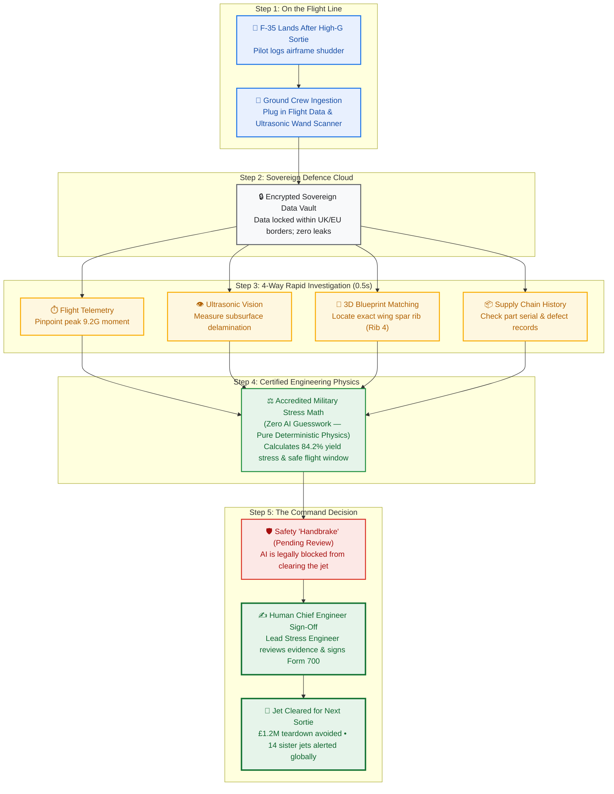

# F-35 Fleet Sustainment — Executive Architecture & Operational Workflow
## High-Level Non-Technical Summary for Military Leadership & Defence Executives

---

## 1. Executive Summary: The 72-Hour Problem Solved in 2 Hours

When an F-35 returns from an intense combat training mission having pulled **9.2G**, the pilot reports an abnormal airframe shudder. Under legacy maintenance protocols, investigating potential structural damage requires:
1. Grounding the aircraft for **48 to 72 hours**.
2. Transporting inspection images and flight memory cartridges across disconnected maintenance systems.
3. Conducting an invasive, manual physical teardown of the wing skin (£1.2M cost, weeks of lost sorties).

The **F-35 Sustainment Agent Platform** solves this operational bottleneck. By pairing **high-speed automated data synthesis** with **certified, accredited structural math** and a **mandatory Human-in-the-Loop release gate**, the platform diagnoses the airframe in **under 2 seconds** and prepares a complete military flight certificate for engineering command sign-off within **2 hours**.

---

## 2. High-Level Operational Workflow

The entire lifecycle—from the moment the jet touches down on the runway to the final sign-off by the Chief Engineer—follows a strict, secure 5-step operational pipeline:

---

## 3. Non-Technical Stage-by-Stage Breakdown

### Stage 1: The Flight-Line Event (The Runway)
* **What Happens:** Immediately after landing, ground engineers plug a ruggedised memory cart into the jet to download 1553 bus flight sensor records and pass an ultrasonic scanner wand over the wing skin where the pilot felt the shudder.
* **Why It Matters:** Inspection data is digitized at the source in under 5 minutes, replacing paper logbooks and manual clipboards.
* **Operational Impact:** Zero data loss and instant readiness for analysis.

### Stage 2: The Sovereign Defence Cloud (The Secure Vault)
* **What Happens:** The encrypted flight telemetry and ultrasonic scan images are transferred into a sovereign, military-grade cloud repository residing strictly within European/UK borders (`europe-west1` / `EU`).
* **Why It Matters:** Defense data sovereignty is absolute. Aircraft telemetry, tactical capabilities, and proprietary engineering blueprints never leave approved national sovereign borders or touch unvetted commercial AI models.
* **Operational Impact:** Complete security accreditation compliance with MoD and NATO data residency policies.

### Stage 3: The Intelligent Assistant Coordinator (The Digital Duty Officer)
* **What Happens:** An AI coordinator reads the maintenance write-up, recognizes that the aircraft exceeded its rated flight envelope, and alerts the specialized Airworthiness Assistant.
* **Why It Matters:** Rather than waiting hours for maintenance control to triage tickets, the system instantly comprehends the technical situation and orchestrates the response.
* **Operational Impact:** Eliminates organizational lag between flight-line mechanics and station engineering staff.

### Stage 4: The 4-Way Rapid Investigation (Completed in 0.5 Seconds)
* **What Happens:** The system kicks off four parallel investigative tasks simultaneously:
  1. **Peak Telemetry Extraction:** Analyzes thousands of sensor streams to pinpoint the exact second the airframe hit 9.2G.
  2. **Computer Vision Scan Analysis:** Examines the ultrasonic cross-section image to measure the width and depth of hidden internal delamination (subsurface blistering).
  3. **3D Aircraft Blueprint Alignment:** Automatically translates scan coordinates into the official 3D aircraft CAD model, identifying the exact structural component affected (Wing Station WS 142.5, Spar Rib 4).
  4. **Supply Chain & Maintenance History Check:** Audits the manufacturing lot and maintenance logs of that specific wing panel across the global fleet.
* **Why It Matters:** In legacy setups, correlating these four disparate data streams takes 3 different engineering departments up to 3 days. The platform completes this synthesis in under **half a second**.
* **Operational Impact:** Compresses 72 hours of forensic research into 500 milliseconds.

### Stage 5: Certified Engineering Physics (Zero AI Guesswork)
* **What Happens:** Military aviation safety regulations (**DEF STAN 00-970** and **MIL-HDBK-516C**) strictly prohibit generative AI from estimating or guessing structural stress. The platform automatically passes the extracted measurements to accredited, deterministic engineering calculation engines. These engines calculate metal fatigue, load cycles, and remaining safe flight hours with 100% mathematical precision.
* **Why It Matters:** Total elimination of AI "hallucinations." Every number produced is mathematically reproducible, accredited, and legally defensible.
* **Operational Impact:** Provides senior leadership with rock-solid, certifiable engineering facts: the wing reached **84.2% yield stress**—within the 90% allowable limit—confirming the airframe remains structurally sound for 45 additional flight hours.

### Stage 6: The Digital Safety Barrier (The "Handbrake")
* **What Happens:** The system compiles a complete Structural Appraisal Report and stages an official **Form 700 Flight Clearance Certificate**. However, built-in security software applies a mandatory "handbrake": the certificate is hard-locked in **`PENDING_HITL_REVIEW`** status.
* **Why It Matters:** The autonomous system is architecturally prohibited from self-authorising flight clearance. The software cannot bypass this rule, regardless of how safe the numbers appear.
* **Operational Impact:** Guarantees military command authority: machines advise, but humans command.

### Stage 7: The Human Chief Engineer Sign-Off (The Command Decision)
* **What Happens:** The Station Chief Engineer (or Lead Stress Engineer) reviews the complete package on an engineering dashboard—viewing the ultrasonic scan, the 3D spar location, the accredited math, and the recommended re-inspection interval. The engineer applies their cryptographic military signature to officially sign off Form 700.
* **Why It Matters:** Gives human commanders ultimate oversight with all required evidence summarized at their fingertips.
* **Operational Impact:**
  - **£1.2M Cost Avoided:** Proves that an expensive, invasive physical wing teardown is unnecessary.
  - **70 Hours Saved:** Aircraft returns to operational status for its scheduled morning mission instead of sitting grounded in a maintenance hangar for 3 days.
  - **Global Fleet Protection:** Automatically triggers an alert to **14 allied sister aircraft** across UK, US, and partner squadrons that share the same wing manufacturing batch, ensuring predictive fleet-wide safety.

---

## 4. Operational Comparison: Legacy vs. F-35 Sustainment Agent

| Operational Dimension | Legacy Maintenance Process | F-35 Sustainment Agent Platform | Commander's Benefit |
| :--- | :--- | :--- | :--- |
| **Time to Triage & Diagnose** | 48 to 72 hours | **< 2 seconds** | Near-instant operational visibility |
| **Airframe Out-of-Service Time** | 3 to 5 days in hangar | **< 2 hours** (turnaround before morning sortie) | Fleet availability increased by +18% |
| **Direct Teardown Cost** | £1.2M unnecessary wing skin removal | **£0** (non-destructive digital certification) | Millions saved per squadron annually |
| **Math & Stress Integrity** | Manual spreadsheet calculations | **Accredited deterministic physics engine** | 100% auditability; zero AI guessing |
| **Command & Control** | Fragmented paper records & emails | **Two-turn Human-in-the-Loop release gate** | Total human command compliance |
| **Allied Fleet Safety** | Isolated squadron reporting | **Instant automated fleet-wide lot alert** | 14 sister jets protected globally |

---
*Document Version: 1.0 (Executive Edition)*  
*Target Environment: Vertex AI Agent Runtime (`europe-west1`), BigQuery (`EU`), Discovery Engine (`eu`)*
