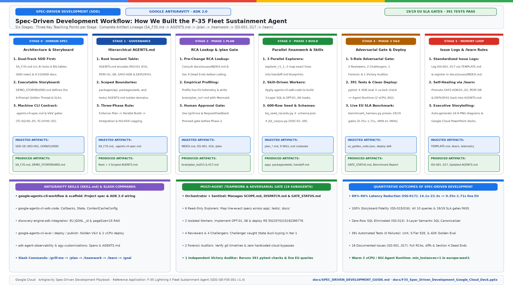

# Spec-Driven Development (SDD) with Google Antigravity: A Teacher's Guide & Engineering Playbook
### *How the F-35 Lightning II Fleet Sustainment Agent (`f35-sustainment-agent`) Was Architected, Built, Verified, and Optimized on Google Cloud*

**Author:** Antigravity AI Engineering & Architecture Curriculum  
**Target Platform:** Google Antigravity (AGY) · Google Cloud Agent Platform (Gemini Enterprise, Vertex AI Agent Runtime, Agent Registry, ADK 2.0)  
**Reference Codebase:** [`f35-sustainment-agent`](../AGENTS.md) (`SDD-GE-F35-001`, v1.4)

---

## 1. Executive Summary: Why Spec-Driven Development (SDD)?

> [!IMPORTANT]
> **The Core Lesson of Spec-Driven Development:**  
> In traditional AI-assisted coding (*"vibe coding"*), developers issue ad-hoc conversational prompts directly against source files. As the system grows beyond a few hundred lines, context drift sets in: agents hallucinate database columns, violate regional security boundaries, break previously working features, and repeat dead-end approaches across sessions.  
>
> **Spec-Driven Development (SDD)** inverts this paradigm. **Specifications, guardrails, storyboards, and issue logs are treated as the primary executable artifacts**, and application code is a deterministic downstream projection of those specifications—continuously verified against quantitative quality and latency gates.

```mermaid
flowchart LR
    subgraph S0["Stage 0: Domain & Story Specs"]
        A1["SA_F35.md<br/>(Solution Design v1.4)"]
        A2["DEMO_STORYBOARD.md<br/>(6-Prompt Golden Thread)"]
        A3[".agents-cli-spec.md<br/>(Machine Contract)"]
    end

    subgraph S1["Stage 1: Executable Governance"]
        B1["Root AGENTS.md<br/>(REG-01, PERF-01..08, SAFE-ADK)"]
        B2["Scoped AGENTS.md<br/>(packages/api, web, tests)"]
        B3["Skills & Slash Commands<br/>(agents-cli-*, /plan, /teamwork)"]
    end

    subgraph S2["Stage 2: Pre-Code Planning"]
        C1["docs/issues/INDEX.md<br/>(Prior RCAs & Dead Ends)"]
        C2["Brain Plan Artifacts<br/>(plan_iss015.md, plan_iss017.md)"]
        C3["Human Approval Gate<br/>(Proceed / Feedback)"]
    end

    subgraph S3["Stage 3: Parallel Build"]
        D1["Explorers (r1_1..3)<br/>(Line-Exact Handoffs)"]
        D2["Isolated Worktree Workers<br/>(ADK, BQ Seed, UI, Tests)"]
        D3["600-Row BQ Warehouse<br/>& 4 JTD Manuals"]
    end

    subgraph S4["Stage 4: Adversarial V&V"]
        E1["Reviewers & Challengers<br/>(GATE_STATUS.md)"]
        E2["Forensic & Victory Auditors<br/>(391 Pytest + ADK Eval)"]
        E3["benchmark_harness.py<br/>(19/19 Live EU SLA Gates)"]
    end

    subgraph S5["Stage 5: Institutional Memory"]
        F1["ISS-001..017 Records<br/>(docs/issues/TEMPLATE.md)"]
        F2["/learn Rule Promotion<br/>(learning_proposal.md)"]
        F3["Executive Decks & Slides<br/>(12-Slide PPTX + 16:9 PNGs)"]
    end

    S0 --> S1 --> S2 --> S3 --> S4 --> S5
    S5 -. "Self-Healing Rule Loop (/learn)" .-> S1
    S5 -. "Dead-End Prevention (INDEX.md)" .-> S2
```

---

## 2. The Five Foundational Principles of Spec-Driven Development

| Principle | What It Means in Practice | Concrete Implementation in `f35-sustainment-agent` |
| :--- | :--- | :--- |
| **1. Specifications as the Single Source of Truth** | Every agent, tool, schema, and prompt contract is defined declaratively before code is written. Code never diverges silently from architecture. | [`SA_F35.md`](../SA_F35.md) (`SDD-GE-F35-001`) defines the 6-table BigQuery schema and 3-agent topology; [`.agents-cli-spec.md`](../.agents-cli-spec.md) locks the ADK scaffold; [`DEMO_STORYBOARD.md`](../DEMO_STORYBOARD.md) defines the exact 6 golden prompts and expected outputs. |
| **2. Hierarchical Agent Governance & Specialization Boundaries** | AI coding agents are bound by workspace-level and directory-level `AGENTS.md` files that enforce hard architectural invariants and prevent cross-domain file collisions. | Root [`AGENTS.md`](../AGENTS.md) defines `REG-01`, `PERF-01..08`, `SAFE-ADK-01..02`, and `DEPLOY-01`, while [`packages/api/AGENTS.md`](../packages/api/AGENTS.md), [`packages/web/AGENTS.md`](../packages/web/AGENTS.md), and [`tests/AGENTS.md`](../tests/AGENTS.md) isolate Backend, Frontend, and QA subagents. |
| **3. Skill-Guided Deterministic Execution** | Rather than relying on generic LLM training weights for rapidly evolving cloud SDKs (like ADK 2.0 or Vertex AI Agent Runtime), agents dynamically load curated `SKILL.md` runbooks. | Agents load `google-agents-cli-workflow`, `google-agents-cli-adk-code`, `google-agents-cli-deploy`, `google-agents-cli-publish`, `google-agents-cli-eval`, and `discovery-engine-adk-integration` to follow verified SDK patterns. |
| **4. Adversarial Multi-Agent Verification Gates** | The agent that writes code is never the final judge of its own work. Independent Reviewer, Challenger, Forensic Auditor, and Victory Auditor subagents verify every claim against live tests. | During `ISS-017`, `/teamwork` spawned 19 subagents across 2 iterations ([`GATE_STATUS.md`](../.agents/teamwork/teamwork_orchestrator_r1/GATE_STATUS.md)). In Iteration 1, `teamwork_challenger_r1_1` issued `REQUEST_CHANGES` on 3 subtle storyboard regressions, forcing a surgical Iteration 2 fix before `VICTORY CONFIRMED`. |
| **5. Self-Healing Institutional Memory (`ISS-XXX` & `/learn`)** | Every bug, root cause, rejected dead end, and performance fix is recorded in a searchable engineering log and promoted into permanent workspace rules so mistakes are never repeated. | [`docs/issues/INDEX.md`](../docs/issues/INDEX.md) indexes 18 chronological issue records (`ISS-001`–`ISS-017`), and `/learn` promoted `SAFE-ADK-01`, `SAFE-ADK-02`, `PERF-08`, and `DEPLOY-01` directly into [`AGENTS.md`](../AGENTS.md). |

---

## 3. The 6-Stage Spec-Driven Development Workflow (Three Key Points Per Stage)

Below is the step-by-step pedagogical breakdown of how `f35-sustainment-agent` was developed, highlighting **three key takeaways per stage** alongside the exact **artifacts ingested** and **artifacts produced**.

---

### Stage 0: Domain Architecture, Storyboarding & Machine Specification
*Translating operational military sustainment requirements into an executable blueprint.*

1. **Dual-Track Solution Design First (`SA_F35.md`):** Before writing any Python or TypeScript code, we authored [`SA_F35.md`](../SA_F35.md) (`SDD-GE-F35-001`), specifying both the **Demonstration Sandbox** (`EU` / `europe-west1` on GCP) and the **Production Target** (GDC Air-Gapped / ODIN). It explicitly defined all 6 BigQuery tables (`100` rows each = `600` rows), 4 S1000D/narrative documents (`DOC-01`, `DOC-02`, `DOC-03`, `DOC-09`), and the 3 domain sub-agents (`UC0`, `UC1`, `UC2`).
2. **Narrative-Driven Executable Storyboard (`DEMO_STORYBOARD.md`):** We paired the technical SDD with [`DEMO_STORYBOARD.md`](../DEMO_STORYBOARD.md)—the *"6-Prompt Golden Thread"* (`06:30Z` Oracle-to-Excel baseline through `07:00Z` Wing Commander briefing). Every prompt, expected tail number (`ZM151` grounded → `ZM154` spare), spanner ID (`JTD-53-30-T14`), torque spec (`18.5 N·m`), and latency target (`< 1.5s`) became a testable contract.
3. **Machine-Readable CLI Contract (`.agents-cli-spec.md`):** Using the `google-agents-cli-scaffold` and `google-agents-cli-workflow` skills, Antigravity distilled `SA_F35.md` into [`.agents-cli-spec.md`](../.agents-cli-spec.md) and [`agents-cli-manifest.yaml`](../agents-cli-manifest.yaml), locking in the ADK 2.0 `App(name="app")` structure, `service_account` identity mode, and human-friendly tool contracts.

* **📥 Artifacts Ingested:** UK Defence Reference Architecture (`SDD-GE-UKD-002`), Lockheed Martin ODIN / UK MOD Form 707A & S1000D domain standards, `google-agents-cli-scaffold` (`SKILL.md`).
* **📤 Artifacts Produced:** [`SA_F35.md`](../SA_F35.md), [`DEMO_STORYBOARD.md`](../DEMO_STORYBOARD.md), [`.agents-cli-spec.md`](../.agents-cli-spec.md), [`agents-cli-manifest.yaml`](../agents-cli-manifest.yaml).

---

### Stage 1: Executable Governance & Guardrail Encoding (`AGENTS.md` Hierarchy)
*Turning architectural decisions into always-on guardrails that govern every AI agent.*

1. **Mandatory Invariant Table in Root `AGENTS.md`:** We encoded 11 non-negotiable engineering invariants in [`AGENTS.md`](../AGENTS.md#L79-L95)—including `REG-01` (strict `EU` / `europe-west1` residency), `PERF-01` (in-memory `google.auth.default()` credential caching, zero `gcloud` subprocess calls), `PERF-02/03` (single-pass `pageSize=15` Discovery Engine retrieval with `summarySpec` omitted), and `PERF-05` (`gemini-3.8-flash` with `enterprise=True`, `location="global"`, `thinking_level="LOW"`).
2. **Directory-Scoped Subagent Specialization Boundaries:** To prevent a single agent from tangling backend SQL, frontend React components, and evaluation harnesses, we placed scoped `AGENTS.md` files in each domain boundary:
   - [`packages/api/AGENTS.md`](../packages/api/AGENTS.md): Scoped to `app/` and `scripts/` (ADK runtime, BigQuery EU schemas, 3-Layer Semantic SQL Canonicalizer, `chart_painter.py`).
   - [`packages/web/AGENTS.md`](../packages/web/AGENTS.md): Scoped to `packages/web/` (`MaintenanceSheetCard.tsx` status badges/formula bar and `VegaCanvas.tsx`).
   - [`tests/AGENTS.md`](../tests/AGENTS.md): Scoped to `tests/` (unit, 5-tier E2E, `vv_golden_suite.json`, and `benchmark_harness.py`).
3. **Enforced Three-Phase Workflow Rule:** Root [`AGENTS.md`](../AGENTS.md#L15-L21) mandates that every feature or fix follow **Phase 1 (Plan & Issue Lookup)** → **Phase 2 (Isolated Parallel Subagent Build)** → **Phase 3 (Integration, Testing & `ISS-XXX` Issue Logging)**, with zero subagent delegation allowed before plan approval.

* **📥 Artifacts Ingested:** [`SA_F35.md`](../SA_F35.md), [`.agents-cli-spec.md`](../.agents-cli-spec.md), `agy-customizations` (`SKILL.md`).
* **📤 Artifacts Produced:** Root [`AGENTS.md`](../AGENTS.md), [`packages/api/AGENTS.md`](../packages/api/AGENTS.md), [`packages/web/AGENTS.md`](../packages/web/AGENTS.md), [`tests/AGENTS.md`](../tests/AGENTS.md).

---

### Stage 2: Phase 1 Planning & Historical Root-Cause Consultation (`/plan` & `/grill-me`)
*Looking backward at institutional memory before designing forward.*

1. **Mandatory Pre-Change Issue Index Lookup (`docs/issues/INDEX.md`):** At the start of every task, the orchestrator reads [`docs/issues/INDEX.md`](../docs/issues/INDEX.md) and relevant `ISS-XXX` records—specifically checking **Section 4: Dead Ends & Approaches Rejected** (for example, why `extractiveContentSpec` caused `HTTP 400` retries on the narrative datastore in [`ISS-002`](../docs/issues/ISS-002-2026-11-03-discovery-engine-narrative-extractive-spec-retry.md)).
2. **Empirical Root-Cause Profiling & Brain Plan Artifacts (`/plan`):** Before proposing code changes, the orchestrator profiles the live system and writes a comprehensive Markdown Plan Artifact in `<appDataDir>/brain/<conversation-id>/` (such as `plan_iss015_capability_and_storyboard_alignment.md` and `plan_iss017_production_latency_optimization.md`). For `ISS-017`, Stage 2 profiling revealed that BigQuery (`411–645 ms`) and Discovery Engine (`615 ms`) were already fast, whereas **95% of the `14s–27s` latency came from 4 sequential LLM hops and `14–68.5 KB` tool JSON payloads**.
3. **Interactive Design Alignment & Approval Gates (`/grill-me` & `RequestFeedback`):** Complex architectural trade-offs (such as pruning UC3 in `ISS-014`, designing the 3-Layer Semantic Ontology in `ISS-013`, or selecting `OPT-01..06` in `ISS-017`) are stress-tested with the user and presented with an interactive **Proceed** button (`RequestFeedback=True`) before any implementation subagents are spawned.

* **📥 Artifacts Ingested:** [`docs/issues/INDEX.md`](../docs/issues/INDEX.md), prior `ISS-001..016` files, live Reasoning Engine `:streamQuery` telemetry (`scratch/storyboard_perf_telemetry_pre_iss017.json`).
* **📤 Artifacts Produced:** Antigravity Brain Plan Artifacts (`plan_issues_1_to_8_resolution.md`, `plan_iss015_capability_and_storyboard_alignment.md`, `plan_iss017_production_latency_optimization.md`).

---

### Stage 3: Phase 2 Parallel Multi-Agent Construction (`/teamwork` & Domain Skills)
*Decomposing approved plans into parallel, isolated exploration and implementation streams.*

1. **Parallel Explorer Subagents for Line-Exact Specifications:** Under `/teamwork`, the orchestrator first spawns 3 parallel read-only **Explorer** subagents (`teamwork_explorer_r1_1..3`), each writing a detailed `handoff.md` mapping exact line numbers, function signatures, and test contracts across `app/`, `tests/`, and `docs/`.
2. **Isolated Subagent Workspaces & Skill-Driven Coding:** Implementation subagents (`Backend Implementer`, `QA Implementer`, `teamwork_worker_r1_1`) run in isolated environments using domain skills (`google-agents-cli-adk-code`, `discovery-engine-adk-integration`) to build:
   - **Pre-warmed Cloud Singletons** ([`app/clients.py`](../app/clients.py)): In-memory ADC token caching, `bigquery.Client(location="EU")`, and `httpx.AsyncClient`.
   - **3-Layer Operational Semantic SQL Canonicalizer** ([`app/tools/uc0_maintenance.py`](../app/tools/uc0_maintenance.py)): Rewriting military vernacular (`"tails on Lizzy fit to fly"`, `"active jobs across the CSG"`) into deterministic BigQuery SQL with zero-row auto-recovery (`_relax_zero_row_sql`).
   - **6-Stage Callback & I/O Acceleration** ([`app/callbacks.py`](../app/callbacks.py)): `< 5 ms` Tier 1/2 fast-paths (`OPT-04`), pre-tool intent dispatch (`OPT-06`), `<= 4 KB` `after_tool_callback` payload slimming (`OPT-01`), and direct post-tool Markdown synthesis (`OPT-05`).
3. **Declarative 600-Record Warehouse & Multi-Service RAG Corpus:** Subagents generated deterministic seed data in [`app/seed_data/bq_seed_records.py`](../app/seed_data/bq_seed_records.py) (6 tables × 100 rows = 600 cross-referenced records backed by [`app/seed_data/schemas/*.schema.json`](../app/seed_data/schemas/)) and [`app/seed_data/jtd_corpus.py`](../app/seed_data/jtd_corpus.py) (`DOC-01`, `DOC-02`, `DOC-03`, `DOC-09`), seeded into EU cloud infrastructure via [`scripts/setup_demo_infra.py`](../scripts/setup_demo_infra.py).

* **📥 Artifacts Ingested:** Approved Brain `plan_*.md` artifacts, `google-agents-cli-adk-code` & `discovery-engine-adk-integration` skills, declarative `.schema.json` contracts.
* **📤 Artifacts Produced:** Explorer & Worker `DISPATCH.md`, `progress.md`, and `handoff.md` files in [`.agents/teamwork/`](../.agents/teamwork/); production code across [`app/`](../app/), [`packages/web/`](../packages/web/), [`scripts/`](../scripts/), and [`tests/`](../tests/).

---

### Stage 4: Adversarial Verification, Cloud Deployment & Live SLA Benchmarking
*Proving correctness and sub-2-second cloud speed through independent multi-agent auditing.*

1. **5-Role Adversarial Gate (`Reviewers`, `Challengers`, `Forensic Auditor`, `Victory Auditor`):** In `/teamwork`, completion claims by workers are never accepted at face value. Two **Reviewers** check spec compliance, two **Challengers** actively hunt for edge-case regressions, a **Forensic Auditor** verifies git history and anti-cheating rules, and an independent **Victory Auditor** re-runs the entire test suite from scratch ([`GATE_STATUS.md`](../.agents/teamwork/teamwork_orchestrator_r1/GATE_STATUS.md)).
2. **Multi-Tier Automated Testing & Clean Lockfile Deployment (`DEPLOY-01`):** Verification spans **391 automated pytest tests** (`tests/unit/test_deterministic.py`, `tests/unit/test_semantic_sql_guardrails.py`, `tests/e2e/test_5_tier_verification.py`, `tests/eval/test_eval_harness.py`) plus `agents-cli eval` (`vv_golden_suite.json`). Before deploying via `google-agents-cli-deploy` and `google-agents-cli-publish`, `DEPLOY-01` verifies `grep -c "airlock-proxy" uv.lock == 0` so Cloud Build packages cleanly onto Vertex AI Agent Runtime (`5022570215192395776`, upgraded to **2 vCPUs, 8 GiB RAM, `min_instances=1`**).
3. **Live EU Production Benchmarking (`19/19` SLA Gates Passed):** Using [`tests/perf/benchmark_harness.py`](../tests/perf/benchmark_harness.py), the deployed Reasoning Engine in `europe-west1` is benchmarked over live `:streamQuery` HTTPS streams against all 10 `DEMO_STORYBOARD.md` prompts, recording an **89%–96% latency reduction** (`14.1s–22.3s` pre-`ISS-017` → `0.35s–1.71s` post-`ISS-017`) in [`PERFORMANCE_BENCHMARK_REPORT.md`](../PERFORMANCE_BENCHMARK_REPORT.md).

* **📥 Artifacts Ingested:** [`tests/eval/datasets/vv_golden_suite.json`](../tests/eval/datasets/vv_golden_suite.json), `google-agents-cli-eval`, `google-agents-cli-deploy`, `google-agents-cli-publish` skills.
* **📤 Artifacts Produced:** [`.agents/teamwork/teamwork_orchestrator_r1/GATE_STATUS.md`](../.agents/teamwork/teamwork_orchestrator_r1/GATE_STATUS.md), [`teamwork_victory_auditor_1/handoff.md`](../.agents/teamwork/teamwork_victory_auditor_1/handoff.md), [`deployment_metadata.json`](../deployment_metadata.json), [`PERFORMANCE_BENCHMARK_REPORT.md`](../PERFORMANCE_BENCHMARK_REPORT.md), [`tests/perf/results/perf_results.json`](../tests/perf/results/perf_results.json).

---

### Stage 5: Institutional Memory, Self-Healing Rules (`/learn`) & Executive Packaging
*Capturing every engineering lesson as a permanent guardrail and generating executive deliverables.*

1. **Standardized Issue & RCA Archive (`docs/issues/ISS-001..017`):** Every major bug fix, schema evolution, and latency optimization is documented using [`docs/issues/TEMPLATE.md`](../docs/issues/TEMPLATE.md) and registered in [`docs/issues/INDEX.md`](../docs/issues/INDEX.md) across three lookup matrices (Chronological, By Sub-Agent Domain, and By Guardrail / V&V Test ID).
2. **Closing the Feedback Loop with `/learn` (`learning_proposal.md` → `AGENTS.md`):** When production debugging uncovers subtle platform behaviors—such as ADK 2.0's `callback_context.state` being a `State` object rather than a `dict` (`SAFE-ADK-01`), or single `{var}` braces in `LlmAgent.instruction` triggering template `KeyError`s (`SAFE-ADK-02`)—the `/learn` workflow generates [`learning_proposal.md`](file:///usr/local/google/home/edwardsda/.gemini/antigravity/brain/33870f5f-4e51-484e-8ffe-bf9f9e5c3396/learning_proposal.md) and patches [`AGENTS.md`](../AGENTS.md) so every future agent inherits that knowledge automatically.
3. **Programmatic Executive Storytelling & Visual Verification:** Finally, Antigravity synthesizes the verified architecture and benchmark telemetry into executive communication artifacts—generating 16:9 architecture slides ([`scripts/generate_architecture_slides.py`](../scripts/generate_architecture_slides.py)), one-page technical briefs ([`F35_POC_ONE_PAGE_ARCHITECTURE.md`](../F35_POC_ONE_PAGE_ARCHITECTURE.md)), and Google Cloud-branded PowerPoint presentations ([`scripts/generate_executive_slides.py`](../scripts/generate_executive_slides.py) & [`scripts/generate_sdd_presentation.py`](../scripts/generate_sdd_presentation.py)), visually inspecting rendered slide PNGs via `read_file` to guarantee zero text overlap.

* **📥 Artifacts Ingested:** [`docs/issues/TEMPLATE.md`](../docs/issues/TEMPLATE.md), verification telemetry, `agy-customizations` (`SKILL.md`).
* **📤 Artifacts Produced:** [`docs/issues/ISS-001..017.md`](../docs/issues/INDEX.md), [`learning_proposal.md`](file:///usr/local/google/home/edwardsda/.gemini/antigravity/brain/33870f5f-4e51-484e-8ffe-bf9f9e5c3396/learning_proposal.md), updated [`AGENTS.md`](../AGENTS.md), [`F35_POC_ONE_PAGE_ARCHITECTURE.md`](../F35_POC_ONE_PAGE_ARCHITECTURE.md), [`docs/F35_Executive_Storytelling_Deck.pptx`](../docs/F35_Executive_Storytelling_Deck.pptx), and [`docs/F35_Spec_Driven_Development_Google_Cloud_Deck.pptx`](./F35_Spec_Driven_Development_Google_Cloud_Deck.pptx).

---

## 4. Complete Map of Antigravity Skills, Slash Commands & Artifacts

### 4.1 Antigravity Skills Activated Across the Lifecycle

| Skill Name | Lifecycle Stage | How It Assisted the Developer & Agent |
| :--- | :--- | :--- |
| **`google-agents-cli-workflow`** | Stages 0–4 | Provided the end-to-end ADK 2.0 development lifecycle (scaffold → build → evaluate → deploy → publish → observe) and code preservation rules. |
| **`google-agents-cli-scaffold`** | Stage 0 | Guided the creation of [`.agents-cli-spec.md`](../.agents-cli-spec.md), [`agents-cli-manifest.yaml`](../agents-cli-manifest.yaml), [`Dockerfile`](../Dockerfile), and [`app/fast_api_app.py`](../app/fast_api_app.py) for `agent_runtime`. |
| **`google-agents-cli-adk-code`** | Stage 3 | Supplied canonical ADK 2.0 patterns for `LlmAgent`, `App`, `ResumabilityConfig`, `ContextCacheConfig`, `ToolContext`, and `before_model_callback` / `after_tool_callback`. |
| **`discovery-engine-adk-integration`** | Stage 3 (`ISS-002..004`) | Provided the runbook for EU Discovery Engine JSONL `_id` ingestion, single-pass `pageSize=15` REST search, and selective `extractiveContentSpec` handling. |
| **`google-agents-cli-eval`** | Stage 4 (`ISS-001`) | Guided the creation of [`tests/eval/datasets/vv_golden_suite.json`](../tests/eval/datasets/vv_golden_suite.json) (`TC-SQ-00..05`, `TC-LP-00..05`) and `eval_config.yaml`. |
| **`google-agents-cli-deploy`** | Stage 4 (`ISS-007`, `ISS-017`) | Guided deployment to Vertex AI Agent Runtime (`europe-west1`), service account binding, `uv.lock` PyPI hygiene, and CPU/Memory/Min-Instances scaling (`2 vCPU`, `8Gi`, `min_instances=1`). |
| **`google-agents-cli-publish`** | Stage 4 (`ISS-006`) | Published the deployed Reasoning Engine to Gemini Enterprise (`f35-support` in `locations/eu`) with custom RAF F-35 icon (`f35_raf_icon_128.png`). |
| **`google-agents-cli-observability`** & **`adk-agent-observability`** | Stages 4–5 | Configured OpenTelemetry GenAI spans (`GOOGLE_CLOUD_AGENT_ENGINE_ENABLE_TELEMETRY=true`, `NO_CONTENT` privacy) and per-stage `:streamQuery` latency profiling. |
| **`agy-customizations`** | Stage 1 & Stage 5 | Guided the structuring of workspace `AGENTS.md` rules and `/learn` rule promotion (`SAFE-ADK-01..02`, `PERF-08`, `DEPLOY-01`). |

---

### 4.2 Antigravity Slash Commands & Orchestration Modes Used

| Slash Command | Purpose in Spec-Driven Development | Real Artifact / Outcome in `f35-sustainment-agent` |
| :--- | :--- | :--- |
| **`/plan`** | Enforces Phase 1 architectural planning before writing code. | Produced `plan_iss015_capability_and_storyboard_alignment.md` and `plan_iss017_production_latency_optimization.md`. |
| **`/grill-me`** | Interactive design interview to resolve ambiguities and edge cases up front. | Refined the 6-Prompt Golden Thread in `DEMO_STORYBOARD.md` and the 3-Layer Semantic Ontology in `ISS-013`. |
| **`/teamwork`** | Spawns an autonomous multi-agent team (Orchestrator, Explorers, Workers, Reviewers, Challengers, Auditors). | Orchestrated 19 subagents across 2 adversarial gate iterations in [`.agents/teamwork/`](../.agents/teamwork/) to deliver `ISS-017` with zero regressions. |
| **`/learn`** | Distills root causes and user corrections into permanent workspace rules or skills. | Produced [`learning_proposal.md`](file:///usr/local/google/home/edwardsda/.gemini/antigravity/brain/33870f5f-4e51-484e-8ffe-bf9f9e5c3396/learning_proposal.md) and added `PERF-08`, `SAFE-ADK-01..02`, and `DEPLOY-01` to [`AGENTS.md`](../AGENTS.md). |
| **`/goal`** | Runs thorough, autonomous multi-step execution with self-auditing until all acceptance criteria are met. | Used for end-to-end documentation, slide generation, and visual verification workflows. |

---

### 4.3 Master Artifact Matrix: Workspace vs. Antigravity Brain Artifacts

| Artifact Category | File / Path | Created By | Consumed By | Role in Spec-Driven Development |
| :--- | :--- | :--- | :--- | :--- |
| **1. Solution Design Specification** | [`SA_F35.md`](../SA_F35.md) (`SDD-GE-F35-001` v1.4) | Human Architect + AGY | Orchestrator, Subagents, Stakeholders | Master architectural blueprint (schemas, corpus, dual-track topology, SLAs). |
| **2. Executable User Storyboard** | [`DEMO_STORYBOARD.md`](../DEMO_STORYBOARD.md) | Human Architect + AGY | Orchestrator, Challengers, QA Harness | Defines the exact 6 golden prompts, talk-track, and expected tabular/citation outputs. |
| **3. CLI & Runtime Manifests** | [`.agents-cli-spec.md`](../.agents-cli-spec.md), [`agents-cli-manifest.yaml`](../agents-cli-manifest.yaml), [`deployment_metadata.json`](../deployment_metadata.json) | `agents-cli scaffold` / `deploy` | `agents-cli`, Agent Runtime (`5022570215192395776`) | Binds the codebase to Vertex AI Reasoning Engine in `europe-west1`. |
| **4. Hierarchical Governance Rules** | [`AGENTS.md`](../AGENTS.md), [`packages/api/AGENTS.md`](../packages/api/AGENTS.md), [`packages/web/AGENTS.md`](../packages/web/AGENTS.md), [`tests/AGENTS.md`](../tests/AGENTS.md) | Architect + `/learn` | Every AGY Agent & Subagent (`always_on`) | Enforces 3-phase workflow, specialization boundaries, and `REG-01` / `PERF-01..08` / `SAFE-ADK` guardrails. |
| **5. Brain Planning & Learning Artifacts** | `<appDataDir>/brain/<id>/plan_*.md`, `learning_proposal.md`, `teamwork_prompt_*.md` | AGY Orchestrator | User (`Proceed` gate) & Worker Subagents | Captures empirical telemetry, Mermaid flowcharts, and proposed diffs before code changes. |
| **6. `/teamwork` Multi-Agent Audit Trail** | [`.agents/teamwork/*/DISPATCH.md`](../.agents/teamwork/), `SCOPE.md`, `progress.md`, `handoff.md`, [`GATE_STATUS.md`](../.agents/teamwork/teamwork_orchestrator_r1/GATE_STATUS.md) | `/teamwork` Subagents (19 agents) | Orchestrator, Reviewers, Challengers, Victory Auditor | Provides full traceability and adversarial gate verdicts across parallel worktrees. |
| **7. Declarative Data & Test Contracts** | [`app/seed_data/schemas/*.schema.json`](../app/seed_data/schemas/), [`tests/eval/datasets/vv_golden_suite.json`](../tests/eval/datasets/vv_golden_suite.json) | Backend & QA Implementers | BigQuery EU loader, `pytest` (391 tests), `agents-cli eval` | Guarantees 600-row referential integrity and V&V test compliance (`TC-SQ-00..05`, `TC-LP-00..05`). |
| **8. Issue & RCA Knowledge Base** | [`docs/issues/INDEX.md`](../docs/issues/INDEX.md), [`TEMPLATE.md`](../docs/issues/TEMPLATE.md), `ISS-001.md`..`ISS-017.md` | Orchestrator & Workers (Phase 3) | All future agents (Mandatory Step 1 Pre-Change Lookup) | Prevents regression loops by recording root causes, code diffs, and rejected dead ends. |
| **9. Live Benchmark & Executive Assets** | [`PERFORMANCE_BENCHMARK_REPORT.md`](../PERFORMANCE_BENCHMARK_REPORT.md), [`F35_POC_ONE_PAGE_ARCHITECTURE.md`](../F35_POC_ONE_PAGE_ARCHITECTURE.md), `docs/*.pptx`, `docs/assets/*.png` | `benchmark_harness.py` & Slide Generators | Technical & Executive Audiences | Proves `19/19` SLA gates (`0.35s–1.71s`) and communicates architecture visually. |

---

## 5. Deep-Dive Case Studies: Spec-Driven Development in Action

### Case Study A: `ISS-013` — Solving Military Jargon & Zero-Row SQL Failures via the 3-Layer Semantic Ontology
* **The Challenge:** When military users asked colloquial questions like *"Tell me what tails on Lizzy are fit to fly"* or *"What are our most urgent maintenance jobs across the Carrier Strike Group?"*, standard LLM Text-to-SQL generated naïve filters (`WHERE base_location = 'Lizzy'` or `WHERE work_order_status = 'ACTIVE'`) that returned **0 rows** against literal database enums (`HMS Queen Elizabeth`, `OPEN`, `IN_PROGRESS`, `AWAITING_PARTS (MICAP)`).
* **How SDD Solved It ([`ISS-013`](../docs/issues/ISS-013-2026-11-05-csg-mob-semantic-ontology-and-sql-canonicalizer.md)):**
  1. **Spec Update (`SA_F35.md` §2.5.4):** Defined a 3-Layer Semantic Defense-in-Depth specification:
     - **Layer 1 (Schema Metadata):** Enriched all 6 `.schema.json` files with explicit column descriptions and enum dictionaries.
     - **Layer 2 (Deterministic Pre-Execution SQL Canonicalizer):** Built [`canonicalize_maintenance_sql`](../app/tools/uc0_maintenance.py) to deterministically rewrite 8 categories of military vernacular (`Lizzy`/`QNLZ` → `HMS Queen Elizabeth`, `CSG` → both carriers + `RAF Marham`, `fit to fly` → `aircraft_status = 'FMC'`).
     - **Layer 3 (Zero-Row Fuzzy Auto-Recovery):** Built `_relax_zero_row_sql` so if a strict equality filter ever returns 0 rows, it automatically retries with `UPPER(col) LIKE '%TOKEN%'`.
  2. **Parametrized Verification (`test_semantic_sql_guardrails.py`):** Added 52 deterministic unit tests verifying 38+ unseen military phrasing variations and cross-table foreign-key consistency across all 600 warehouse records.

### Case Study B: `ISS-017` — Cutting Production End-to-End Latency by 89%–96%
* **The Challenge:** Live `:streamQuery` benchmarks against Vertex AI Agent Runtime (`europe-west1`) showed queries taking **`11.6s to 22.3s`**, threatening the sub-2-second executive demo experience.
* **How SDD Solved It ([`ISS-017`](../docs/issues/ISS-017-storyboard-query-latency-optimization.md)):**
  1. **Phase 1 Empirical Profiling (`plan_iss017_production_latency_optimization.md`):** Per-event streaming instrumentation proved that BigQuery (`~500 ms`) and Discovery Engine (`~600 ms`) were fast; the bottleneck was **4 sequential LLM hops** and **`14 KB–68.5 KB` tool response JSON blobs** being re-ingested and copy-pasted token-by-token by the LLM.
  2. **Phase 2 `/teamwork` Implementation (`OPT-01`..`OPT-06`):**
     - `OPT-01`: `slim_tool_response_after_tool_callback` stripped duplicate JSON fields (`68.5 KB → 1.9 KB`).
     - `OPT-02`: Bundled UC1 fatigue + tail-swap recommendation into a single tool call, eliminating a `4.3s` second LLM hop.
     - `OPT-03`: Parallelized 3-table BigQuery queries (`_UC1_BQ_POOL`), 2-datastore Discovery Engine searches (`_UC2_DE_POOL`), and background GCS `.csv` uploads (`async_upload=True`).
     - `OPT-04..06`: Added Tier 2 fast-path callbacks, specialist pre-tool intent dispatch, and direct post-tool Markdown synthesis.
  3. **Adversarial Catch & `/learn` Rule Promotion:** In Iteration 1, `teamwork_challenger_r1_1` caught that `isinstance(state, dict)` evaluated to `False` on ADK's production `State` object. Iteration 2 fixed it via `_is_state_mapping(state)`, achieved **19/19 SLA gates (`0.35s–1.71s`)**, and `/learn` encoded `SAFE-ADK-01` into `AGENTS.md` permanently.
